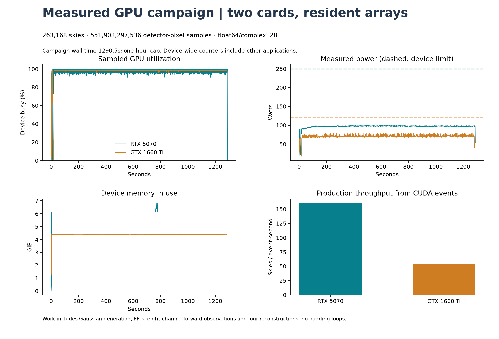
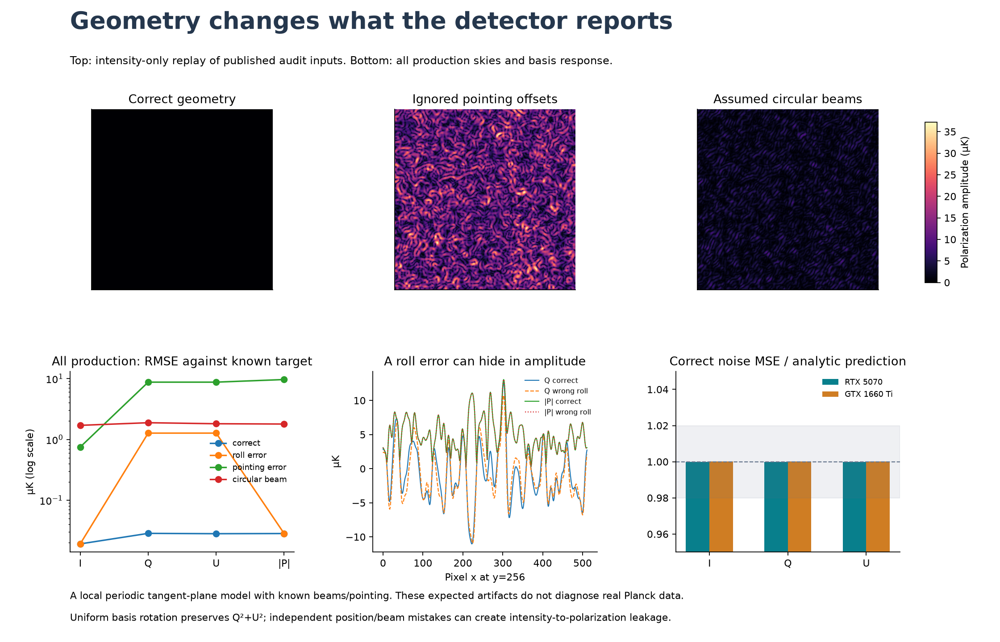

# GPU acquisition geometry: measured result

**geometry_checks_passed: 263,168 synthetic skies in 1290.50s.**
The campaign processed 551,903,297,536 detector-pixel values
and four reconstructions of each observation, within the 3600 s cap. This is a
controlled acquisition-model test, not a new cosmological result or actual Planck TOD.
The detector-pixel count is the equivalent size of the eight-channel observation
grids, processed spectrally. Those full grids are not all retained on disk.

## Hardware use

| GPU | Production skies | Batch | Mean sampled busy | Samples at ≥90% busy | Mean power | Peak allocated tensors |
|---|---:|---:|---:|---:|---:|---:|
| RTX 5070 | 196,608 | 64 | 97.08% | 99.18% | 97.0W | 5.255GiB |
| GTX 1660 Ti | 65,536 | 32 | 97.63% | 98.93% | 71.0W | 2.750GiB |

The device counters were sampled once per second and include other applications.
CUDA event times and allocated/reserved memory are retained per batch/device.
Busy percentage is not percentage of theoretical FLOPS, memory capacity or power
limit. This FP64 workload need not draw maximum rated power; no clocks or power
settings were changed and no meaningless loops padded the run. Throughput is
for this declared model, not a comparison against the previous, different pipeline.

## Measurement geometry and indexed channels

Each raster position produces eight detector readings from a known local I/Q/U
sky. Arrival position, oblique beam incidence, ellipse orientation, pointing
offsets, gain and polarization orientation are separate metadata. A calibrated
Fourier-space inverse estimates three components at a common beam resolution.
The [32 corrected labeled sample rows](../results/acquisition_v1/labeled_samples_corrected.csv)
include sample/time indices, channel, angular x/y, detector look coordinates,
incidence/beam/polarization angles and µK readings. The 1 ms raster cadence is
artificial. Angular position is this model's spatial index; radial depth is not inferred.

The first four readings share raster-time index 0 and pixel (0,0); their
detector look positions differ. Values below use unwrapped local coordinates:

| Sample | Time index | Channel | Look x (deg) | Look y (deg) | Incidence (deg) | Polarization angle (deg) | Reading (µK) |
|---:|---:|---:|---:|---:|---:|---:|---:|
| 0 | 0 | 0 | -10.029297 | -10.000000 | 0 | 20 | -69.93832 |
| 1 | 0 | 1 | -10.020716 | -10.020716 | 10 | 42.5 | -75.84418 |
| 2 | 0 | 2 | -10.000000 | -10.029297 | 20 | 65 | -91.80557 |
| 3 | 0 | 3 | -9.979284 | -10.020716 | 30 | 87.5 | -105.88737 |

**Coordinate-label correction:** the frozen Fourier phase samples at nominal
position minus the pointing offset. The original CSV labeled nominal-plus-offset
coordinates as pointing. Its bytes are preserved. The corrected view retains
those old values under explicit registration labels and supplies actual look
coordinates, with and without periodic wrapping. An independent analytic cosine
test resolves the sign convention; forward/inverse agreement alone cannot do so.
See the [erratum](ACQUISITION_COORDINATE_ERRATUM.md) and
[coordinate audit](../results/acquisition_v1/coordinate_export_audit.json).
The simulation, observations and reconstruction metrics were not changed.

True incidence angles range 0–60 degrees. Beam major sigma is 1.2/cos(incidence)
pixels, minor 1.2; target beam sigma 3 pixels. Four inverses assume correct geometry,
a +10 degree roll offset, zero pointing offsets, or circular beams. See the
[frozen protocol](ACQUISITION_SPEC.md) for the complete equations and limitations.

## Measured reconstruction errors

Production pooled RMSE against the known common-resolution target, in µK:

| Assumed geometry | I | Q | U | Polarization amplitude |
|---|---:|---:|---:|---:|
| correct | 0.0191026 | 0.0284688 | 0.0281164 | 0.028292 |
| roll_error | 0.0191026 | 1.26847 | 1.26848 | 0.028292 |
| pointing_error | 0.748061 | 8.73872 | 8.73843 | 9.65076 |
| circular_beam | 1.70278 | 1.87985 | 1.8089 | 1.78909 |

Each wrong-assumption case reconstructs the same observations and noise as the
correct case. The top image is a display-only intensity-only replay of the
published primary audit input, separate from the 256-per-device intensity-only
control cohorts. It illustrates false polarization from pointing/beam errors;
cohort statistics are preserved in NPZ files and the final verification.

Measured reconstructed polarization RMS in the pooled 512 intensity-only control
skies, including detector noise, in µK (the true Q/U are zero):

| Assumed geometry | Polarization RMS |
|---|---:|
| correct | 0.0400027 |
| roll_error | 0.0400027 |
| pointing_error | 12.3614 |
| circular_beam | 2.6059 |

Uniform roll changes Q/U while leaving their amplitude invariant. The maximum
scaled amplitude differences were [6.570131002479527e-14, 6.309169274687621e-14].
This known degeneracy explains why an amplitude-only feature cannot identify
an absolute orientation error in this constructed setting. It is not a newly
discovered physical effect or an explanation of previous Planck discrepancies.

| GPU | Noise-free max I/Q/U RMSE (µK) | Max scaled CPU audit error | Max scaled roll-amplitude difference | Noise MSE / prediction, I/Q/U |
|---|---:|---:|---:|---|
| RTX 5070 | 2.46e-14 | 1.84e-13 | 6.57e-14 | 0.999938, 0.999963, 1.000019 |
| GTX 1660 Ti | 2.46e-14 | 1.9e-13 | 6.31e-14 | 1.000065, 1.000064, 1.000125 |

Noise-free absolute recovery and scaled precision limits were 1e-10;
the preset relative noise-variance gate was 2%.
Rank-deficient orientation coverage is rejected in the independently checked
CPU/JoVin negative control; no pseudoinverse manufactures a reconstruction.

## Provenance, numerical checks and formal scope

All production metrics are finite. The two full-resolution audit inputs are
published with the result. Each is independently computed on NumPy CPU and
checked against its producing GPU, including full maps and observations. The
primary input is also reconstructed on the secondary GPU; scaled metric
difference **3.72064e-16**, limit 1e-10. Production GPU
draws are not all recomputed on CPU: the audit scope is two full-resolution
inputs, small real-device fixtures, static geometry checks, every-batch roll
invariance and the aggregate exact-noise prediction. GPU RNG reproducibility
is limited to recorded device/backend/batch shapes; published audit inputs
support checks independent of RNG implementation.

The new JoVin receipt `20261023T232459Z-151d1b4bcb0e` checks shipped CPU kernels
and recorded actual CUDA outputs from both cards. The separate coordinate receipt
is `20261023T234104Z-58f1101a658f`. All 23 current suites verify
(152 checks including collection); local tests 192 passed, three unavailable
Intel XPU skips; all 23 CI-equivalent sandbox suites passed. The sandbox does
not execute CUDA. Fresh [verification](../results/acquisition_v1/verification.json)
authenticates receipts/chain membership and checks current source/test hashes,
all prior frozen artifacts, production/control metrics, audit inputs and formal
source/compiler records. No SHA match proves physical validity or novelty.

Two new exact rational [Lean identities](../formal/PolarizationGeometry.lean)
prove preservation of polarization norm and a co-rotated projection under
c²+s²=1. They were kernel-checked with the same official SHA-pinned Lean 4.35.0.
They do not prove floating-point inversion, valid optics or real-world calibration.
The earlier nine rational invariants remain unchanged.

A development-only CUDA workspace OOM occurred before scientific freeze. Its
[failure record](../data/evidence/acquisition_workspace_failure.json) and archived
source are preserved. Static solves were bounded in chunks of 256 with CPU conditioning
diagnostics; no scientific thresholds or model assumptions were tuned to pass.

This periodic tangent-plane instrument uses a fixed local Stokes basis and
synthetic red Gaussian fields, not full spherical spin-2 CMB physics or a
validated Planck/MWD instrument. Real timeline analysis would need pointing,
beam/bandpass/calibration, noise and coordinate-basis provenance. The earlier
observational foreground/reference mismatch remains unresolved.

[Plan](../results/acquisition_v1/plan.json),
[result](../results/acquisition_v1/result.json),
[sampled telemetry](../results/acquisition_v1/telemetry.json),
[performance summary](../results/acquisition_v1/performance.json),
[primary audit input](../results/acquisition_v1/audit_input_cuda0.npz),
[secondary audit input](../results/acquisition_v1/audit_input_cuda1.npz).
