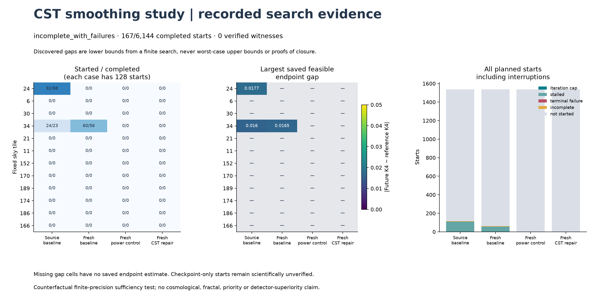
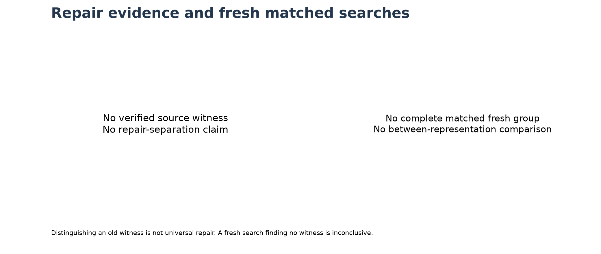
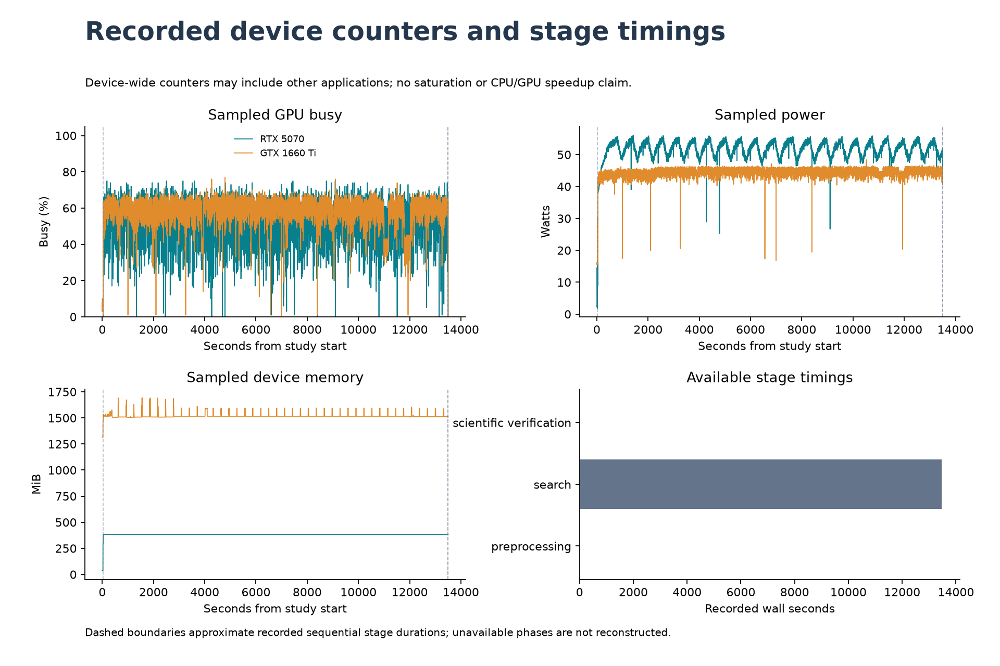

# CST information-loss search under angular smoothing

**Scientific status: incomplete_with_failures. Outcome: no_verified_witness_found.**
Completed starts: **167/6,144**;
started: 176; terminal nonfinite failure starts: 0;
started rows without retained GPU endpoints: 0.
Separately recorded non-timeout optimizer/execution case failures: **1**.
Independently audited saved endpoints: 176.
Saved verified witnesses: **0**. Elapsed study time: 13502.22 seconds.
The result file is present.

## Actual coverage and limits

Searches began in **3/48 cases**;
45 cases never started. Of 176
started rows, 167 completed the solver stopping rule
and 9 remained interrupted. Completed status counts:
167 stalled and
0 reached the iteration cap.
Initial retraction failures among started rows: 0.
Directions: maximize: 148 started / 143 completed; minimize: 28 started / 24 completed. The fixed order was truncated by the budget;
these unequal direction counts cannot be treated as a balanced completed search.

| Planned search | Started / planned cases | Starts begun | Starts completed |
|---|---:|---:|---:|
| source / baseline | 2 / 12 | 116 | 111 |
| fresh / baseline | 1 / 12 | 60 | 56 |
| fresh / capacity | 0 / 12 | 0 | 0 |
| fresh / repair | 0 / 12 | 0 | 0 |

The capacity, repair searches were entirely unstarted. Their resistance to fresh searches was not tested, so no comparison or repair-performance conclusion is available.
The largest saved feasible endpoint gap was **0.017660102450468743**, against the fixed
witness threshold **0.05**. It is a finite-search discovered
lower bound, not an upper bound on undiscovered gaps or evidence of closure.
Independent CPU covariance/derivative and stored GPU endpoint audits cover
176 saved starts; their maximum recorded
scaled discrepancy was 8.2429471521384482e-15 (acceptance gate 1e-10).
No provisional candidate met the declared witness threshold, so no production full-harmonic direct replay or production invariant certificate was performed. The separately recorded real-operator preflight verifies only its fixed-angle controls.

## What the experiment asks

The supplied CST paper §8.1 says that a reduced deterministic operator can exist
only if equal representations have equal representations after the same transition.
Here the transition is declared angular smoothing, not cosmic or spacecraft time.
The states are bounded counterfactuals built from the existing real 143 GHz A/B
harmonics. They are not newly observed skies or a foreground/instrument model.

The [frozen protocol](CLOSURE_FIBERS_SPEC.md) fixes 12 tiles and 6,144 starts.
Each tile has a source-baseline search and fresh baseline, power-control and CST-
repair searches, with 128 starts each. The orthogonal-plane construction is
designed to preserve global E/B auto/cross spectra and the full A−B difference
at each common smoothing time; preflight controls verify those identities.
An independently replayed production invariant certificate is conditional on a
selected witness candidate, as disclosed above. Throughout the search, accepted
states must keep perturbation RMS within 25% of the reference coadd globally
and within the tile, with plane angles bounded by ±π/4.

The baseline records 32 transported increment statistics and 12 local band powers.
The power control adds four derivatives of mean increment power; the CST repair
instead adds four derivatives of connected fourth-order structure. Reference-
centered local bins have width 0.001 robust-scale units, with a 1e-7 margin;
normalized global spectral bins have width 1e-6. A witness requires matching
current bins and a future 2° K4 gap ≥ 0.05, verified on independent CPU, both
actual GPUs and direct harmonic-sampling routes inside the scientific budget.

These are **finite-precision implemented representations**. A witness does not
prove nonclosure of every exact continuous summary, establish new cosmology,
measure a fractal dimension or establish detector superiority. No witness found
means only that this finite search found none; its maximum is a discovered lower
bound, never a certified worst-case upper bound or uniform error bound under §8.2.

## All planned search cases

The status plot includes stalls, iteration caps, interruptions and unstarted
rows. Missing values are not replaced with zero discoveries. Endpoint gaps may
be uncertified when the run ended before scientific verification; their scope
is retained in [report_summary.json](../results/closure_fibers_v1/report_summary.json).
Recorded nonfinite trial events: 0; rejected
proposals and terminal numerical failures remain separately recorded.

| Tile | Search | Started / completed | Terminal failures | Unverified started | Largest saved feasible gap | Certificate |
|---:|---|---:|---:|---:|---:|---|
| 24 | source / baseline | 92 / 88 | 0 | 0 | 0.0176601 | no_verified_witness |
| 24 | fresh / baseline | 0 / 0 | 0 | 0 | — | not_verified |
| 24 | fresh / capacity | 0 / 0 | 0 | 0 | — | not_verified |
| 24 | fresh / repair | 0 / 0 | 0 | 0 | — | not_verified |
| 6 | source / baseline | 0 / 0 | 0 | 0 | — | not_verified |
| 6 | fresh / baseline | 0 / 0 | 0 | 0 | — | not_verified |
| 6 | fresh / capacity | 0 / 0 | 0 | 0 | — | not_verified |
| 6 | fresh / repair | 0 / 0 | 0 | 0 | — | not_verified |
| 30 | source / baseline | 0 / 0 | 0 | 0 | — | not_verified |
| 30 | fresh / baseline | 0 / 0 | 0 | 0 | — | not_verified |
| 30 | fresh / capacity | 0 / 0 | 0 | 0 | — | not_verified |
| 30 | fresh / repair | 0 / 0 | 0 | 0 | — | not_verified |
| 34 | source / baseline | 24 / 23 | 0 | 0 | 0.0160138 | no_verified_witness |
| 34 | fresh / baseline | 60 / 56 | 0 | 0 | 0.0165349 | no_verified_witness |
| 34 | fresh / capacity | 0 / 0 | 0 | 0 | — | not_verified |
| 34 | fresh / repair | 0 / 0 | 0 | 0 | — | not_verified |
| 21 | source / baseline | 0 / 0 | 0 | 0 | — | not_verified |
| 21 | fresh / baseline | 0 / 0 | 0 | 0 | — | not_verified |
| 21 | fresh / capacity | 0 / 0 | 0 | 0 | — | not_verified |
| 21 | fresh / repair | 0 / 0 | 0 | 0 | — | not_verified |
| 11 | source / baseline | 0 / 0 | 0 | 0 | — | not_verified |
| 11 | fresh / baseline | 0 / 0 | 0 | 0 | — | not_verified |
| 11 | fresh / capacity | 0 / 0 | 0 | 0 | — | not_verified |
| 11 | fresh / repair | 0 / 0 | 0 | 0 | — | not_verified |
| 152 | source / baseline | 0 / 0 | 0 | 0 | — | not_verified |
| 152 | fresh / baseline | 0 / 0 | 0 | 0 | — | not_verified |
| 152 | fresh / capacity | 0 / 0 | 0 | 0 | — | not_verified |
| 152 | fresh / repair | 0 / 0 | 0 | 0 | — | not_verified |
| 170 | source / baseline | 0 / 0 | 0 | 0 | — | not_verified |
| 170 | fresh / baseline | 0 / 0 | 0 | 0 | — | not_verified |
| 170 | fresh / capacity | 0 / 0 | 0 | 0 | — | not_verified |
| 170 | fresh / repair | 0 / 0 | 0 | 0 | — | not_verified |
| 189 | source / baseline | 0 / 0 | 0 | 0 | — | not_verified |
| 189 | fresh / baseline | 0 / 0 | 0 | 0 | — | not_verified |
| 189 | fresh / capacity | 0 / 0 | 0 | 0 | — | not_verified |
| 189 | fresh / repair | 0 / 0 | 0 | 0 | — | not_verified |
| 174 | source / baseline | 0 / 0 | 0 | 0 | — | not_verified |
| 174 | fresh / baseline | 0 / 0 | 0 | 0 | — | not_verified |
| 174 | fresh / capacity | 0 / 0 | 0 | 0 | — | not_verified |
| 174 | fresh / repair | 0 / 0 | 0 | 0 | — | not_verified |
| 186 | source / baseline | 0 / 0 | 0 | 0 | — | not_verified |
| 186 | fresh / baseline | 0 / 0 | 0 | 0 | — | not_verified |
| 186 | fresh / capacity | 0 / 0 | 0 | 0 | — | not_verified |
| 186 | fresh / repair | 0 / 0 | 0 | 0 | — | not_verified |
| 166 | source / baseline | 0 / 0 | 0 | 0 | — | not_verified |
| 166 | fresh / baseline | 0 / 0 | 0 | 0 | — | not_verified |
| 166 | fresh / capacity | 0 / 0 | 0 | 0 | — | not_verified |
| 166 | fresh / repair | 0 / 0 | 0 | 0 | — | not_verified |

## Preserved execution failures and numerical warnings

Case-level exceptions are separate from the terminal nonfinite-start counter.
Timeouts at the reserved verification boundary are reported as interruptions;
the following table lists other preserved case exceptions.

| Case | Exception type | Recorded final error | Evidence |
|---|---|---|---|
| tile_34_source_baseline | FloatingPointError | FloatingPointError: stored search state lost feasibility | [case record](../results/closure_fibers_v1/cases/tile_34_source_baseline.json), [saved starts](../results/closure_fibers_v1/cases/tile_34_source_baseline.npz) |

The [runtime arithmetic notes](../results/closure_fibers_v1/runtime_notes.json)
retain the following comparisons of saved values with the stricter optimizer
inner gate. These are metadata calculations, not new feature recomputations.

| Case / start | Maximum saved scaled change | Optimizer inner gate | Excess over inner gate | Bin-boundary margin | Required certificate margin |
|---|---:|---:|---:|---:|---:|
| tile_34_source_baseline / 21 | 0.00049980000000024298 | 0.00049980000000000001 | 2.4296970685400154e-16 | 1.9999999975703515e-07 | 9.9999999999999995e-08 |

A tiny excess over the optimizer inner gate while the saved certificate margin
remains safe is consistent with roundoff at that stricter boundary. This is a
**provisional diagnosis** of the preserved failure. It neither overrides the
frozen solver decision nor certifies a witness; no source, seed or tolerance was
changed to turn the failure into a pass.

The [preserved run log](../results/closure_fibers_v1/run.log) contains 1 SVD convergence warning(s): the initially selected CUDA driver did not converge for a batch and PyTorch announced a more accurate fallback. The warning does not state that the fallback failed.

## Does the proposed repair distinguish the examples?

Only independently verified source witnesses enter the following table.
Distinguishing one known example does not establish universal repair.

| Source tile | Verified future K4 gap | Power control distinguishes | CST repair distinguishes |
|---:|---:|---|---|
| — | No verified source witness | — | — |

Fresh comparisons are restricted to complete equal-budget triples with saved
scientific endpoint audits. Eligible tiles: [].
All other groups remain visible but are not used to compare representations.
Failure to find a fresh collision is resistance to this particular search,
not a proof of sufficiency or a detection-power advantage.

## Directly replayed candidates and numerical margins

Every directly replayed selected candidate appears below, including rejected or
precision-failed candidates. Only rows labeled `verified_witness` support a
collision claim. The current margin is the smallest distance to a recorded local
bin boundary in robust-scale units (required ≥ 1e-7); spectral, split-difference
and direct-sampling errors use the declared scaled numerical gate 1e-10.
RMS columns are global / tile perturbation ratios (each required ≤ 0.25).
Linked arrays retain all 52 before/after summaries, response derivatives,
rotation parameters, bin IDs and both actual GPU replays. Certificates retain
the future changed-coordinate safety decision and detailed invariant checks.

| Tile / search / representation | Verification status | Current minimum margin | Maximum spectral error | Maximum split-difference error | Direct feature error | RMS ratios | Saved evidence |
|---|---|---:|---:|---:|---:|---:|---|
| — | No directly replayed candidate | — | — | — | — | — | — |

The following values are the primary 2° K4 summary, with each cell showing
**reference / candidate** after the indicated identical smoothing. Steps 2/3
are descriptive trajectories of the selected pair, not additional searches.

| Tile / search / representation | u=0 | u=1 | u=2 | u=3 | Absolute u=1 gap |
|---|---:|---:|---:|---:|---:|
| — | No directly replayed candidate | — | — | — | — |

## Verification, proofs and provenance

The publication audit reads saved evidence and performs hash, count, bin, margin,
bound and certificate-consistency arithmetic only. It does not run new physical
transforms, feature extraction, optimization or direct scientific checks after
the four-hour cap. Its metadata-integrity status is separate from the scientific
status above. [Verification](../results/closure_fibers_v1/verification.json) authenticates
all current JoVin receipts and current source/test bindings, plus preservation of
all earlier frozen artifacts. SHA256 identifies bytes, not physical truth.

Local regression log: 211 passed, 3 skipped,
0 failed and 0 errors; available: True.
Saved plain-CPU sandbox passes: 25. JoVin validates the shipped
CPU bundle and separately recorded actual CUDA fixtures; the sandbox does not
execute CUDA or the full scientific search.

The actual-device profile is `data/evidence/closure_gpu_preflight_v3.json`,
SHA256 `d6f9830bb875cb0132f7d93b637d166247b14dfb8880044fdb1d34b1beeb8c07`. The frozen closure JoVin
receipt is `20261024T124021Z-15f74d97a919`, covering bundle SHA256
`2490a6c1637776c0233912ffbd8700037973ede17104c46b88feaeca04a9f647`. Input and source SHA256 maps,
software versions, stored numerical rotation bases and initialization manifests
are bound in [plan.json](../results/closure_fibers_v1/plan.json). The supporting
proof receipt is `data/evidence/closure_lean.json`, SHA256 `1eac6fc3df1d894e85fdd1f1710eb8fe738b9c8ccbedd7b8158b32d2e4a9931e`.
Frozen source revision: `0095635562e866d4f1a1babc505c626037748a3e`.

Seven new pinned Lean kernel checks cover the conditional no-factor criterion
and an exact rational toy counterexample. Together with the earlier 11 identities,
there are 18 supporting theorems. They do not prove Float64 correctness, successful
optimization, physical sky behavior, novelty or universal closure of the repair.
Development preflight/source archives and failed checks are retained; earlier
results and their frozen numerical modules are not rewritten.

## Time and hardware evidence

| Available stage | Wall seconds |
|---|---:|
| preprocessing seconds | 24.250 |
| search seconds | 13476.307 |
| scientific verification seconds | 1.624 |

Approximate phases below use the same cumulative completed-stage boundaries as
the figure. Counters remain actual saved device-wide samples; phase boundaries
are approximate and incomplete stages are not reconstructed.

| Approximate phase | GPU | Samples | Mean busy (%) | Mean power (W) | Peak memory (MiB) |
|---|---:|---:|---:|---:|---:|
| preprocessing | 0 | 23 | 0.00 | 3.31 | 35 |
| preprocessing | 1 | 23 | 5.35 | 15.79 | 1317 |
| search | 0 | 12092 | 54.14 | 51.75 | 384 |
| search | 1 | 12092 | 58.61 | 44.51 | 1693 |
| scientific verification | 0 | 1 | 0.00 | 44.37 | 384 |
| scientific verification | 1 | 1 | 1.00 | 40.49 | 1513 |

The scientific wall cap is 14,400 seconds, including preprocessing and scientific
verification; new batches stop at 13,500 seconds to reserve 900 seconds. Publication
formatting and metadata-only authentication are outside that cap. Device-wide
counters may include other applications. Recorded activity is not a percentage
of theoretical FLOPS and establishes neither saturation nor CPU/GPU speedup.
Saved timing audit: completed-stage sum 13502.181401774998
seconds; recorded elapsed beyond the declared cap
0.0 seconds; hard-cap marker
present: False. The approximate recorded
verification start was 13500.557218875
seconds, with 0.5572188749993074
seconds beyond the planned reserve boundary. Missing timing values mean an
unfinished phase was not recorded; scheduling delays are not normalized away.
The recorded UTC interval is `2026-10-24T12:54:16.120734+00:00` to
`2026-10-24T16:32:31.137489+00:00`, a difference of
13095.016755 seconds. The saved `perf_counter` elapsed
value is 13502.224764858 seconds, differing from the UTC interval
by 407.20800985799906 seconds (`perf_counter` minus UTC).
Both records are preserved. This report does not infer a cause for that discrepancy.

## What is known and what remains open

- **Proved:** the conditional mathematical implication and the finite rational toy.
- **Measured:** only saved, explicitly certified counterfactual witnesses and recorded search outcomes.
- **Inferred:** a verified collision rules out an autonomous factor map for this declared recorded representation on a domain containing that pair.
- **Unknown:** closure outside the tested domain, universal repair, physical origin, primordial structure and general superiority.

The supplied paper is referenced by its existing audited package hash and section
numbers. It is not redistributed or assigned new attribution by this work.
