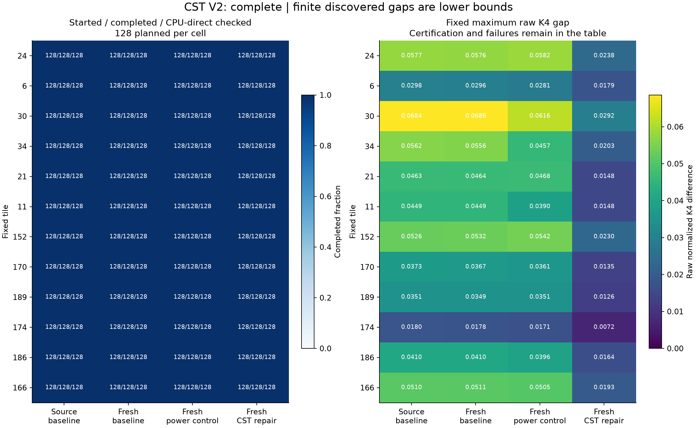
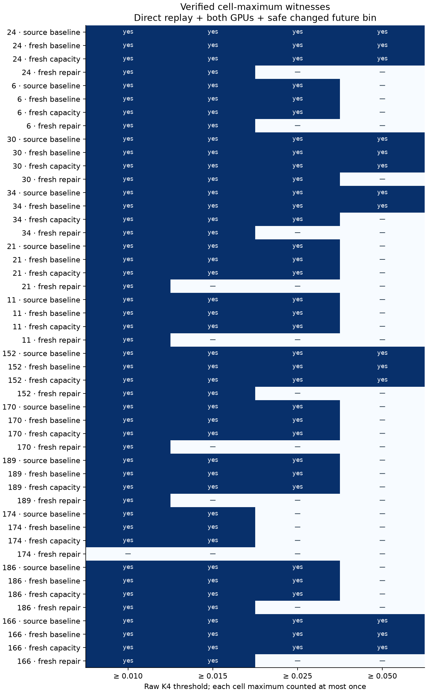
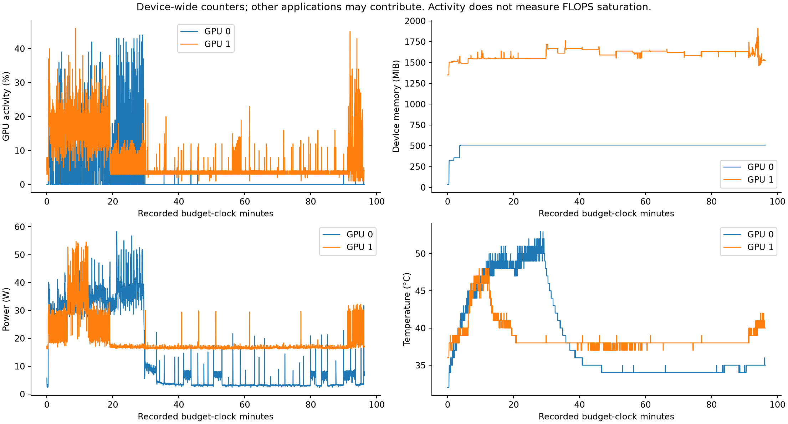

# CST smoothing fibers V2: saved evidence

Scientific status: **complete**. Completed starts:
**6,144/6,144**; started:
6,144; independently CPU/direct checked:
6,144. Started endpoints still unverified:
0. Terminal numerical starts:
0; recorded verification failures:
0. These are finite counterfactual searches,
anchored to real Planck 143 GHz splits, not new observed skies or cosmological detections.
Safely matching-current/different-future cell-maximum pairs:
**48/48**.
The no-factor criterion itself requires different safe future bins; the raw-gap
tiers additionally grade the size of that difference and do not define equality.

## Meaning of the thresholds

The primary response is the dimensionless normalized connected fourth-order K4
at 2 degrees after one common additional Gaussian smoothing step. Each tier below
is a **raw K4 difference**, not a multiple of a robust-scale bin width. Current
local feature bins have width 0.001 robust-scale units and a minimum safety margin
of 1e-5 robust-scale units. Global normalized spectral bins have width 1e-6.
Direct sampling epsilon is 1e-12 and the scaled numerical agreement gate is 1e-10.

| Raw K4 gap at least | Reported cell-maximum witnesses (≤48) | Separately qualified CPU/direct/search-GPU rows |
|---:|---:|---:|
| 0.010 | 47 | 6016 |
| 0.015 | 43 | 5504 |
| 0.025 | 34 | 4287 |
| 0.050 | 14 | 1098 |

A reported cell-maximum witness requires independent full-harmonic replay,
matching safe current bins, all invariants and bounds, actual all-feature checks
on both GPUs at u=0,1,2,3, and a safely changed future representation bin. The
separate per-row count uses independent CPU/direct and its archived assigned
search-GPU outputs; it does not imply both GPUs evaluated every row. Each started
start's best saved endpoint is replayed even when its gap is below every tier.
The cell maximum is fixed before numerical rejection; a failed maximum is never
replaced by a passing runner-up. All discovered maxima are **lower bounds from
a finite search**, not worst-case upper bounds, physical ceilings or proofs of closure.

## All 48 planned cases

Counts are started/completed/CPU-direct checked. Missing cells remain explicit.
Maximum gaps without finished certification are provisional; saved precision
failures are retained instead of being counted as witnesses.

| Tile | Search | Starts S/C/V | Terminal failures | Fixed maximum raw gap | Verification / maximum status |
|---:|---|---:|---:|---:|---|
| 24 | source baseline | 128/128/128 | 0 | 0.05774 | complete / certified_endpoint |
| 24 | fresh baseline | 128/128/128 | 0 | 0.0575796 | complete / certified_endpoint |
| 24 | fresh capacity | 128/128/128 | 0 | 0.058159 | complete / certified_endpoint |
| 24 | fresh repair | 128/128/128 | 0 | 0.0237828 | complete / certified_endpoint |
| 6 | source baseline | 128/128/128 | 0 | 0.0298101 | complete / certified_endpoint |
| 6 | fresh baseline | 128/128/128 | 0 | 0.0296293 | complete / certified_endpoint |
| 6 | fresh capacity | 128/128/128 | 0 | 0.0280758 | complete / certified_endpoint |
| 6 | fresh repair | 128/128/128 | 0 | 0.0179452 | complete / certified_endpoint |
| 30 | source baseline | 128/128/128 | 0 | 0.0684031 | complete / certified_endpoint |
| 30 | fresh baseline | 128/128/128 | 0 | 0.0685924 | complete / certified_endpoint |
| 30 | fresh capacity | 128/128/128 | 0 | 0.0616452 | complete / certified_endpoint |
| 30 | fresh repair | 128/128/128 | 0 | 0.0292073 | complete / certified_endpoint |
| 34 | source baseline | 128/128/128 | 0 | 0.0561758 | complete / certified_endpoint |
| 34 | fresh baseline | 128/128/128 | 0 | 0.0556285 | complete / certified_endpoint |
| 34 | fresh capacity | 128/128/128 | 0 | 0.0457071 | complete / certified_endpoint |
| 34 | fresh repair | 128/128/128 | 0 | 0.0203098 | complete / certified_endpoint |
| 21 | source baseline | 128/128/128 | 0 | 0.0463221 | complete / certified_endpoint |
| 21 | fresh baseline | 128/128/128 | 0 | 0.0464113 | complete / certified_endpoint |
| 21 | fresh capacity | 128/128/128 | 0 | 0.0468138 | complete / certified_endpoint |
| 21 | fresh repair | 128/128/128 | 0 | 0.0147892 | complete / certified_endpoint |
| 11 | source baseline | 128/128/128 | 0 | 0.0449333 | complete / certified_endpoint |
| 11 | fresh baseline | 128/128/128 | 0 | 0.0449356 | complete / certified_endpoint |
| 11 | fresh capacity | 128/128/128 | 0 | 0.0390498 | complete / certified_endpoint |
| 11 | fresh repair | 128/128/128 | 0 | 0.014798 | complete / certified_endpoint |
| 152 | source baseline | 128/128/128 | 0 | 0.0525994 | complete / certified_endpoint |
| 152 | fresh baseline | 128/128/128 | 0 | 0.0531742 | complete / certified_endpoint |
| 152 | fresh capacity | 128/128/128 | 0 | 0.054209 | complete / certified_endpoint |
| 152 | fresh repair | 128/128/128 | 0 | 0.0229786 | complete / certified_endpoint |
| 170 | source baseline | 128/128/128 | 0 | 0.0373192 | complete / certified_endpoint |
| 170 | fresh baseline | 128/128/128 | 0 | 0.0367472 | complete / certified_endpoint |
| 170 | fresh capacity | 128/128/128 | 0 | 0.036081 | complete / certified_endpoint |
| 170 | fresh repair | 128/128/128 | 0 | 0.0134629 | complete / certified_endpoint |
| 189 | source baseline | 128/128/128 | 0 | 0.0350714 | complete / certified_endpoint |
| 189 | fresh baseline | 128/128/128 | 0 | 0.0348716 | complete / certified_endpoint |
| 189 | fresh capacity | 128/128/128 | 0 | 0.0350864 | complete / certified_endpoint |
| 189 | fresh repair | 128/128/128 | 0 | 0.0126215 | complete / certified_endpoint |
| 174 | source baseline | 128/128/128 | 0 | 0.0180497 | complete / certified_endpoint |
| 174 | fresh baseline | 128/128/128 | 0 | 0.0178394 | complete / certified_endpoint |
| 174 | fresh capacity | 128/128/128 | 0 | 0.0171099 | complete / certified_endpoint |
| 174 | fresh repair | 128/128/128 | 0 | 0.00718078 | complete / certified_endpoint |
| 186 | source baseline | 128/128/128 | 0 | 0.041007 | complete / certified_endpoint |
| 186 | fresh baseline | 128/128/128 | 0 | 0.0409972 | complete / certified_endpoint |
| 186 | fresh capacity | 128/128/128 | 0 | 0.0395616 | complete / certified_endpoint |
| 186 | fresh repair | 128/128/128 | 0 | 0.0164347 | complete / certified_endpoint |
| 166 | source baseline | 128/128/128 | 0 | 0.0509644 | complete / certified_endpoint |
| 166 | fresh baseline | 128/128/128 | 0 | 0.0511238 | complete / certified_endpoint |
| 166 | fresh capacity | 128/128/128 | 0 | 0.0504517 | complete / certified_endpoint |
| 166 | fresh repair | 128/128/128 | 0 | 0.0193391 | complete / certified_endpoint |

## Numerical margins and RMS bounds

RMS columns have the explicit order **tile, global**. Both ratios must be ≤0.25;
angles must stay within ±π/4. The margin is in robust-scale units, whereas the gap
is raw normalized K4. Detailed direct/matrix/CPU/GPU errors, all four-time
spectral and fixed-split-difference checks, parameter vectors and SHA-256 bindings
are retained in [the row/cell certificates](../results/closure_fibers_v2/certificates_v2).

| Case | Fixed maximum start | Raw gap | Current minimum margin | RMS ratios: tile, global | Maximum scaled error | Status |
|---|---:|---:|---:|---|---:|---|
| 24 source baseline | 56 | 0.05774 | 0.000499139 | 0.0992126, 0.034723 | 4.22977e-14 | certified_endpoint |
| 24 fresh baseline | 63 | 0.0575796 | 0.000499304 | 0.0988423, 0.0347363 | 3.24786e-14 | certified_endpoint |
| 24 fresh capacity | 57 | 0.058159 | 0.000499841 | 0.0940088, 0.0371674 | 4.72656e-14 | certified_endpoint |
| 24 fresh repair | 86 | 0.0237828 | 0.000499986 | 0.103409, 0.0376276 | 2.67675e-14 | certified_endpoint |
| 6 source baseline | 72 | 0.0298101 | 0.000499589 | 0.1446, 0.0407154 | 2.29081e-14 | certified_endpoint |
| 6 fresh baseline | 120 | 0.0296293 | 0.000499577 | 0.144231, 0.0406711 | 4.15927e-14 | certified_endpoint |
| 6 fresh capacity | 18 | 0.0280758 | 0.000499605 | 0.107212, 0.0303274 | 3.81743e-14 | certified_endpoint |
| 6 fresh repair | 18 | 0.0179452 | 0.000499823 | 0.168668, 0.0465736 | 4.4982e-14 | certified_endpoint |
| 30 source baseline | 95 | 0.0684031 | 0.000499728 | 0.168913, 0.046168 | 3.18e-14 | certified_endpoint |
| 30 fresh baseline | 121 | 0.0685924 | 0.000499947 | 0.167887, 0.0460678 | 2.78049e-14 | certified_endpoint |
| 30 fresh capacity | 20 | 0.0616452 | 0.0005 | 0.191514, 0.0472782 | 4.72432e-14 | certified_endpoint |
| 30 fresh repair | 120 | 0.0292073 | 0.000499485 | 0.177028, 0.0399118 | 4.75671e-14 | certified_endpoint |
| 34 source baseline | 22 | 0.0561758 | 0.000499519 | 0.0949428, 0.0355092 | 1.03201e-14 | certified_endpoint |
| 34 fresh baseline | 54 | 0.0556285 | 0.00049997 | 0.0941569, 0.0351223 | 4.80409e-15 | certified_endpoint |
| 34 fresh capacity | 59 | 0.0457071 | 0.000499912 | 0.098032, 0.0313412 | 1.24753e-14 | certified_endpoint |
| 34 fresh repair | 62 | 0.0203098 | 0.00049999 | 0.123229, 0.0395118 | 9.75248e-15 | certified_endpoint |
| 21 source baseline | 37 | 0.0463221 | 0.000499999 | 0.17028, 0.0433768 | 1.09494e-14 | certified_endpoint |
| 21 fresh baseline | 59 | 0.0464113 | 0.000499375 | 0.170742, 0.0436106 | 1.54901e-14 | certified_endpoint |
| 21 fresh capacity | 59 | 0.0468138 | 0.000499954 | 0.17447, 0.0451122 | 9.92033e-15 | certified_endpoint |
| 21 fresh repair | 1 | 0.0147892 | 0.000499979 | 0.127916, 0.0368914 | 1.24989e-14 | certified_endpoint |
| 11 source baseline | 42 | 0.0449333 | 0.000499966 | 0.10655, 0.0367948 | 1.27615e-13 | certified_endpoint |
| 11 fresh baseline | 8 | 0.0449356 | 0.000499482 | 0.106035, 0.0367043 | 5.77397e-14 | certified_endpoint |
| 11 fresh capacity | 31 | 0.0390498 | 0.000499582 | 0.0922716, 0.0329435 | 8.36154e-14 | certified_endpoint |
| 11 fresh repair | 71 | 0.014798 | 0.000499962 | 0.135332, 0.0423471 | 4.37658e-14 | certified_endpoint |
| 152 source baseline | 34 | 0.0525994 | 0.000499985 | 0.180902, 0.0542843 | 4.39476e-14 | certified_endpoint |
| 152 fresh baseline | 25 | 0.0531742 | 0.000499176 | 0.18219, 0.0545637 | 4.80809e-14 | certified_endpoint |
| 152 fresh capacity | 66 | 0.054209 | 0.000499659 | 0.159007, 0.0554175 | 4.05875e-14 | certified_endpoint |
| 152 fresh repair | 74 | 0.0229786 | 0.000499687 | 0.126598, 0.042066 | 2.12408e-14 | certified_endpoint |
| 170 source baseline | 6 | 0.0373192 | 0.000499922 | 0.118315, 0.0335982 | 1.48712e-14 | certified_endpoint |
| 170 fresh baseline | 53 | 0.0367472 | 0.000499021 | 0.116668, 0.032973 | 8.00922e-15 | certified_endpoint |
| 170 fresh capacity | 60 | 0.036081 | 0.000499001 | 0.110706, 0.0316148 | 1.26986e-14 | certified_endpoint |
| 170 fresh repair | 67 | 0.0134629 | 0.000499451 | 0.107006, 0.0301318 | 4.33796e-15 | certified_endpoint |
| 189 source baseline | 107 | 0.0350714 | 0.000499885 | 0.143379, 0.0426812 | 2.35878e-13 | certified_endpoint |
| 189 fresh baseline | 114 | 0.0348716 | 0.000499855 | 0.142985, 0.0424541 | 1.78956e-13 | certified_endpoint |
| 189 fresh capacity | 52 | 0.0350864 | 0.000499694 | 0.15849, 0.0470628 | 2.82363e-13 | certified_endpoint |
| 189 fresh repair | 71 | 0.0126215 | 0.00049927 | 0.100729, 0.0395811 | 3.83933e-13 | certified_endpoint |
| 174 source baseline | 50 | 0.0180497 | 0.000499563 | 0.0887212, 0.0300666 | 2.01454e-14 | certified_endpoint |
| 174 fresh baseline | 37 | 0.0178394 | 0.000499868 | 0.087571, 0.0297761 | 1.456e-14 | certified_endpoint |
| 174 fresh capacity | 27 | 0.0171099 | 0.000499564 | 0.0853082, 0.0292087 | 1.69949e-14 | certified_endpoint |
| 174 fresh repair | 73 | 0.00718078 | 0.000499349 | 0.0746461, 0.0263286 | 2.5498e-14 | certified_endpoint |
| 186 source baseline | 102 | 0.041007 | 0.000499916 | 0.243168, 0.0532648 | 3.75686e-14 | certified_endpoint |
| 186 fresh baseline | 116 | 0.0409972 | 0.000499675 | 0.242431, 0.0531586 | 3.36471e-14 | certified_endpoint |
| 186 fresh capacity | 77 | 0.0395616 | 0.000499897 | 0.243718, 0.0518221 | 4.40197e-14 | certified_endpoint |
| 186 fresh repair | 51 | 0.0164347 | 0.000499978 | 0.188529, 0.0455938 | 9.49677e-14 | certified_endpoint |
| 166 source baseline | 14 | 0.0509644 | 0.000499868 | 0.140651, 0.0377145 | 3.76983e-14 | certified_endpoint |
| 166 fresh baseline | 50 | 0.0511238 | 0.00049987 | 0.140781, 0.0378032 | 2.70974e-14 | certified_endpoint |
| 166 fresh capacity | 12 | 0.0504517 | 0.000499392 | 0.137948, 0.0413843 | 3.54265e-14 | certified_endpoint |
| 166 fresh repair | 25 | 0.0193391 | 0.000499095 | 0.0946609, 0.033977 | 2.81266e-14 | certified_endpoint |

Across 6144 saved row audits, the smallest current
margin was 0.0004990000744. The largest saved
matrix/direct error was 7.92333e-13,
and the largest both-GPU/direct error was
3.83933e-13, against the fixed
1e-10 numerical gate. Maximum spectral and split-difference errors were
2.31234e-15 and
4.13899e-16. Maximum RMS ratios in
tile/global order were [0.24475398624169628, 0.055610241804765814].

## Does the added information distinguish source witnesses?

Only reported source-baseline witnesses enter this table. Distinguishing one
source pair supports that specific augmentation; it does not establish universal
sufficiency. Fresh baseline, capacity-control and CST-repair searches use common
initializations. Complete, equal-budget, independently audited fresh triples:
**12 tiles**, IDs [24, 6, 30, 34, 21, 11, 152, 170, 189, 174, 186, 166].
Unequal or incomplete triples remain in
the coverage table and are not promoted to completed comparisons.

| Source tile | Raw future gap | Ordinary-power response distinguishes | Connected-fourth response distinguishes |
|---:|---:|---|---|
| 24 | 0.05774 | True | True |
| 6 | 0.0298101 | True | True |
| 30 | 0.0684031 | True | True |
| 34 | 0.0561758 | True | True |
| 21 | 0.0463221 | True | True |
| 11 | 0.0449333 | True | True |
| 152 | 0.0525994 | True | True |
| 170 | 0.0373192 | True | True |
| 189 | 0.0350714 | True | True |
| 174 | 0.0180497 | True | True |
| 186 | 0.041007 | True | True |
| 166 | 0.0509644 | True | True |

| Tile | Complete matched triple | Fresh baseline raw maximum | Fresh power-control raw maximum | Fresh CST-repair raw maximum |
|---:|---|---:|---:|---:|
| 24 | yes | 0.0575796 | 0.058159 | 0.0237828 |
| 6 | yes | 0.0296293 | 0.0280758 | 0.0179452 |
| 30 | yes | 0.0685924 | 0.0616452 | 0.0292073 |
| 34 | yes | 0.0556285 | 0.0457071 | 0.0203098 |
| 21 | yes | 0.0464113 | 0.0468138 | 0.0147892 |
| 11 | yes | 0.0449356 | 0.0390498 | 0.014798 |
| 152 | yes | 0.0531742 | 0.054209 | 0.0229786 |
| 170 | yes | 0.0367472 | 0.036081 | 0.0134629 |
| 189 | yes | 0.0348716 | 0.0350864 | 0.0126215 |
| 174 | yes | 0.0178394 | 0.0171099 | 0.00718078 |
| 186 | yes | 0.0409972 | 0.0395616 | 0.0164347 |
| 166 | yes | 0.0511238 | 0.0504517 | 0.0193391 |

Only the complete, certified matched triples enter this aggregate comparison.
Threshold counts use raw K4 gaps ≥0.010 / 0.015 / 0.025 / 0.050 and safe future
bin separation, counting each cell maximum once.

| Fresh representation | Matched cases | Safe quantized collisions | Four tier counts | Smallest maximum | Median maximum | Largest maximum |
|---|---:|---:|---|---:|---:|---:|
| baseline | 12 | 12 | 12 / 12 / 11 / 5 | 0.0178394 | 0.0456734 | 0.0685924 |
| capacity | 12 | 12 | 12 / 12 / 11 / 4 | 0.0171099 | 0.0426343 | 0.0616452 |
| repair | 12 | 12 | 11 / 7 / 1 / 0 | 0.00718078 | 0.01719 | 0.0292073 |

The CST-repair discovered maximum was lower than baseline on
12/12
matched tiles and lower than the power control on
12/12.
The median paired repair/baseline ratio was
0.389577; the power-control
ratio was 0.973427.
These observations support the usefulness of the connected-fourth response
features for this task and solver. They do not identify a universal sufficient
representation: repair still produced
12 certified quantized
collisions, of which
11 verified witnesses at
the 0.010 tier. Both augmentations distinguish
12 and 12,
respectively, of the 12 reported source witnesses.
The power-control search found a larger gap than baseline on
4 tiles despite its more
constrained domain. Different optimization paths can expose different endpoints;
this reinforces why the observed maxima are lower bounds and why this experiment
does not establish closure, physical ceilings, statistical significance or general superiority.

## Preserved failures and incomplete verification

Recorded solver status counts: {'stalled': 6144}. Final rejection-reason
counts: {'box_bound': 6144}. A `stalled` stop records the
frozen 50-consecutive-rejection condition; `box_bound` is the retained last
rejection reason. These records establish algorithm termination, not convergence
to a global optimum or a certified maximum.

| Case / start | Status or exception | Evidence |
|---|---|---|
| — | No recorded failure | All missing cells remain visible above |

Checkpoint arrays carry their own global start IDs and phase. If execution stops
between replacing the NPZ and its companion JSON, recovery uses the NPZ IDs;
stale or absent JSON is diagnosed explicitly and never shifts a second GTX batch
onto starts 0–63. A recovered angle has no newly measured GPU endpoint or CPU
certificate; missing measurements remain unverified.

| Case | NPZ global start IDs | Identity source | NPZ checkpoint phase | Companion-write diagnosis |
|---|---|---|---|---|
| — | — | — | — | No interrupted checkpoint pair recorded |

## Hardware and the bounded run

The production cap is 14400.0
seconds, including preprocessing, optimization and independent replay; the final
900.0 seconds are reserved for finishing
verification. One eight-thread CPU replay worker overlaps GPU search. Recorded
monotonic elapsed: 5781.36 s; UTC elapsed:
5610.34 s; budget clock (maximum of both):
5781.36 s. The saved UTC interval runs from
`2026-10-24T17:28:19.461661+00:00` to `2026-10-24T19:01:49.755279+00:00`.
Both clocks and any discrepancy are preserved. GPU counters are device-wide and
can include other applications; activity does not establish FLOPS saturation or
CPU/GPU speedup. Post-cap reporting and verification use only saved values and
hashes, with no new science or candidate promotion.
The recorded monotonic-minus-UTC discrepancy is
171.013272 seconds; its cause is unknown.
The budget gate used the larger clock. Preprocessing, search and pipelined CPU
verification overlap, so their durations are not summed as disjoint wall time.

## What is proved, measured, inferred and unknown

- **Proved:** 24 supporting theorem declarations in pinned
  Lean 4.35.0: 9 scale/moment identities, 2 polarization identities, 7 conditional
  closure/toy results, and 6 concrete recorded-bin results for source tile 24,
  start 56. The 6 concrete results are axiom-free. They check all 44 current/future
  integer-bin entries, including the primary future distinction **232 ≠ 1007**,
  and specialize the unchanged conditional no-factor theorem. Their application
  to the measured sky pipeline explicitly assumes those recorded tables and
  equality of the complete retained current global representation. They do not
  certify Float64 quantization, direct sampling, GPU arithmetic, the raw 0.05
  threshold, or physical interpretation. The older algebraic results may use
  Lean's standard foundational axioms as disclosed by their receipts.
- **Measured:** only the saved, explicitly qualified counterfactual endpoints,
  numerical errors, margins, bounds, coverage and device counters.
- **Inferred:** a verified matching-current/different-future pair rules out an
  autonomous factor map for this declared finite-precision representation on a
  domain containing that pair.
- **Unknown:** exact continuous-summary closure, universal repair, physical
  origin, primordial structure, fractal dimension and general superiority.

| Formal support | Theorems | Saved status | Source | Compiler receipt |
|---|---:|---|---|---|
| Scale and moment identities | 9 | passed | [ScaleInvariance.lean](../formal/ScaleInvariance.lean) | [lean_verification.json](../results/multiscale_v1/lean_verification.json) |
| Polarization rotation identities | 2 | passed | [PolarizationGeometry.lean](../formal/PolarizationGeometry.lean) | [acquisition_lean.json](../data/evidence/acquisition_lean.json) |
| Conditional closure and rational toy | 7 | passed | [OperationalClosure.lean](../formal/OperationalClosure.lean) | [closure_lean.json](../data/evidence/closure_lean.json) |
| Concrete V2 recorded-bin witness | 6 | passed | [ClosureFibersV2Witness.lean](../formal/ClosureFibersV2Witness.lean) | [closure_v2_first_witness_lean.json](../data/evidence/closure_v2_first_witness_lean.json) |

Provenance is in [the frozen plan](../results/closure_fibers_v2/plan.json),
[result](../results/closure_fibers_v2/result.json), [report summary](../results/closure_fibers_v2/report_summary.json)
and [metadata/receipt verification](../results/closure_fibers_v2/verification.json). The frozen
plan binds source, input data, numerical planes, initialization, protocol and
current JoVin receipts; verification binds the final report and plot bytes.
V1 outputs and its protocol are preserved byte for byte. The supplied CST paper
is referenced under its existing package provenance and is not redistributed.
