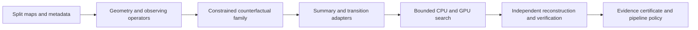

# CST qualification for CMB pipelines: research and integration plan

Research date: 2026-10-24. Scope: general CMB pipelines, rather than a specific
collaboration. Status: the first HEALPix/NaMaster integration slice is implemented
in [the API guide](CMB_INTEGRATION_V1.md), with a separately frozen synthetic
[H1 pilot protocol](CUTSKY_FEASIBILITY_SPEC.md). The wider program below remains
proposed research. Existing frozen studies remain unchanged.

## Recommendation and evidence

Begin with a six-to-eight-week cut-sky feasibility project. Expand into a
24-month integration and validation program only after that project demonstrates
a useful, nontrivial counterfactual family with independently checked observing
operators. Months 25–36 would support a second independent deployment and
maintenance, conditional on partner demand and measured scientific value.

The product should qualify a **specified representation, transition, admissible
domain and numerical precision**. A finite adversarial search cannot issue a
universal closure certificate. Statistical sufficiency for cosmological
parameters and operational closure under a chosen transition are different
requirements; a closure counterexample alone does not demonstrate bias in r or
EB, or invalidate an otherwise calibrated inference pipeline. Testing that link
is part of the proposed research.

The [completed v2 study](CLOSURE_FIBERS_V2_RUN.md), published at commit
`a7e69dbf2ee307b8836fa72d5c47c541ef9a3e18`, supplies motivation:

| Existing evidence | Supported interpretation |
|---|---|
| 6,144 starts, all independently replayed; 48 verified matching-current/different-future cell maxima | Concrete finite-precision representation failures in the declared Planck counterfactual domain |
| 14 cell maxima reached raw K4 gap 0.050 | A thresholded effect-size count, distinct from input quantization |
| Fresh CST-repair maxima lower on all 12 tiles; median paired reduction 61% | Useful evidence for these response features under this solver and domain |
| Smaller certified repair collisions on all 12 tiles | The four added features do not establish sufficiency |
| All starts stopped by stalling, with final rejection reason `box_bound` | Discovered lower bounds, without certified global optimization |
| 26 authentic JoVin suites / 177 checks and 24 supporting Lean declarations | Scoped provenance, numerical checks and mathematical statements, not experiment readiness |

Earlier [response](RESPONSE_BENCHMARK_RUN.md) and
[targeted](TARGETED_RUN.md) benchmarks found no validated detection gain. Those
negative results remain part of the evidence base; v2 does not reverse them.

## Corrections to the four-pillar roadmap

**Backends already exist in part.** The current code uses ducc0 spin-2 transforms
and direct sampling, with NumPy/GPU transport matrices accelerating the search.
The missing layer is a general data/operator contract, rather than an entirely
new spherical transform implementation. See [spectra.py](../src/cmbcst/spectra.py),
[real_splits_data.py](../src/cmbcst/real_splits_data.py) and
[closure_fibers_data.py](../src/cmbcst/closure_fibers_data.py).

**A fixed split difference is an empirical constraint.** It is not a complete
noise model, an independent noise realization, or proof that a counterfactual
is astrophysically probable. Split differences may contain signal mismatch or
systematics. Report the locked quantity and its processing stage explicitly.

**Cut-sky locking requires new constraints.** NaMaster's mode-coupling relation
connects ensemble-average pseudo-spectra to underlying spectra; it does not
preserve an individual realization's masked spectra under our rotations.
[NaMaster's estimator tutorial](https://namaster.readthedocs.io/en/stable/1BasicFunctionality.html)
and [spin-field tutorial](https://namaster.readthedocs.io/en/stable/2Spin.html)
describe the distinction and E/B mixing.

**The named component-separation methods have different interfaces.** NILC,
SMICA, SEVEM and Commander are not one common plugin API. Common-beam smoothing
is a useful integration point, but not a universal description of their
processing; Commander can handle multiple native resolutions.
[Planck's component-separation methods](https://www.aanda.org/articles/aa/full_html/2020/09/aa33881-18/aa33881-18.html)
provide concrete examples.

**Verification is already automated in important parts.** V2's runner performs
row verification, and its reporting/verifier scripts and pinned-Lean CI are
automated. The next work is reusable packaging, deployment qualification and
scientific calibration, rather than replacing a wholly manual audit.

## Scientific questions and stopping conditions

| ID | Research question | Evidence needed to proceed |
|---|---|---|
| H1 | Can a useful family preserve the actual selected cut-sky observables and split difference? | Finite nonzero candidates, direct NaMaster replay, rank/conditioning diagnostics and all declared bounds |
| H2 | Do connected-fourth response features reduce relevant ambiguity beyond equal-capacity controls? | Fresh matched searches and independent simulation holdouts; equal simulation/training budgets |
| H3 | Does the diagnostic identify scientifically consequential compressor failures? | A predeclared relationship to parameter bias, coverage, foreground residuals or sensitivity, tested under realistic nuisance models |
| H4 | Can another analysis team reproduce and use the result at acceptable cost? | An independently reproduced pilot, resource measurements and operation alongside its established baseline |

Failure of H1 should stop the promised cut-sky manifold integration and produce
a documented feasibility result. Failure of H2 or H3 should stop claims of added
scientific performance, while preserving any useful diagnostic infrastructure.
No stage requires a positive discovery to count as honest completed research.

For H1, freeze a positive minimum continuation/perturbation amplitude before
searching the future objective, expressed as a fraction of reference coadd RMS
and separated from the independently measured numerical floor by a declared
factor. Tiny nonzero steps inside finite bins do not establish useful freedom.
Require finite continuation beyond that minimum at fixed lock tolerances, and
report a prospectively specified tolerance study. Stop if admissible motion only
shrinks toward zero as the equality tolerances tighten.

External documentation was checked through Context7 where indexed and otherwise
through maintainer documentation and primary papers. Some pages track development
versions. They establish design considerations, not a tested dependency lock;
the feasibility project must pin exact releases/commits and build environments.

## Architecture and first supported interfaces



Keep the existing `cmbcst` package name initially. Add new, separately versioned
modules and protocols around frozen numerical implementations. Proposed API
names below are design sketches, not currently available functions:

```python
pair = SplitPair.from_files(paths, geometry=geometry, response=response,
                           units=units, polarization=convention)
family = generate_counterfactual_family(pair, constraints=constraints,
                                        max_planes=128, backend=backend)
report = qualify_representation(family, summary=summary,
                                transition=transition, protocol=protocol)
```

Distribute a small code package with optional backend dependencies and compact
fixtures. Keep large replay archives in a separately versioned evidence store,
with authenticated content hashes, access controls where needed and explicit
retention costs. Preserve the existing published evidence and paper restrictions.

A convenience call is reasonable once these contracts are satisfied. It must
reject missing information rather than infer a physical noise model from two
file names. Prefer “counterfactual family” over “null manifold”: the construction
does not yet define a calibrated sampling distribution under a physical null.

| Contract | Mandatory content |
|---|---|
| Split maps | Q/U components, units, coordinate frame/local basis, polarization convention, validity masks, split provenance and hashes |
| Geometry | HEALPix NSIDE/ordering or explicit WCS/pixel coordinates and integration weights |
| Harmonic state | E/B layout, normalization, real-field symmetry, band limits, coadd and full split difference |
| Observing operator | Synthesis, adjoint, optional analysis/solve, beam/pixel/filter response, inner products and reconstruction residuals |
| Family | Stored numerical bases, effective dimension/rank, allowed angles, perturbation bounds and locked observables |
| Transition/summary | Mathematical definition, units, feature scales, quantization, masks, fitted weights and version identifiers |

FITS and HDF5 readers should be separate from transforms. HDF5 requires a schema;
its extension does not specify sky coordinates or polarization convention.
Cross-format tests can require identical canonical bytes for identical lossless
arrays; unit conversions require declared numerical agreement, not an assumption
that semantically equivalent inputs have identical hashes.

Start with HEALPix/ducc0 and a healpy conformance reference, then add pixell CAR/WCS
support. Ducc distinguishes synthesis, its adjoint and approximate analysis;
these must not be advertised as interchangeable exact inverses on masked maps.
[Ducc operator definitions](https://mtr.pages.mpcdf.de/ducc/sht.html).
Healpy's handling of unseen pixels also needs explicit masking tests.
[Healpy map analysis](https://healpy.readthedocs.io/en/latest/generated/healpy.sphtfunc.map2alm.html).
Pixell supplies spin-aware WCS transforms and its own map I/O; documented
curved-sky methods use ducc, so pixell-versus-ducc agreement is an adapter check,
not an independent transform engine.
[Pixell reference](https://pixell.readthedocs.io/en/latest/reference.html).

Keep SHTns optional until a CMB spin-2 bridge is demonstrated. Its documented
scalar/vector transforms do not by themselves establish Q/U spin-2 support.
[Vector definitions](https://nschaeff.bitbucket.io/shtns/vsh.html).
Its GPU path also needs a tested build/device combination and separate plans
for concurrent use; benchmark end-to-end transfers and setup.
[SHTns GPU documentation](https://nschaeff.bitbucket.io/shtns/gpu.html).

## Cut-sky feasibility: the first research work package

Write M=(A+B)/2 and D=A−B, so A=M+D/2 and B=M−D/2. A common increment to both
canonical splits preserves D algebraically. If raw observations instead have
different response operators O_A and O_B, a common latent increment δM changes
their difference by (O_A−O_B)δM. Specify the space in which D is locked and test
that the claim survives the actual processing chain.

A band-limited alm output locks only the represented difference. Preserve any
unmodeled residual when returning full maps, or clearly limit the certificate to
the retained harmonic subspace; do not silently claim that omitted pixel/high-ℓ
information is also locked. CST should complement validated E/B purification,
without claiming to recover ambiguous cut-sky modes or replace that estimator.

For fixed mask, purification and linear preprocessing, write an observed
harmonic response as Kx. A selected realized bandpower is a quadratic form
q_b(x)=xᵀQ_bx, with Q_b=KᵀP_bK in real coordinates. A full-sky rotation G that
preserves ordinary spectra need not satisfy GᵀQ_bG=Q_b. Therefore retain the
existing rotations as **proposals**, and explicitly constrain the actual
masked outputs. This is a proposed mathematical design, not an established
NaMaster guarantee.

1. Freeze a scalar apodized mask, beam/pixel response, field configuration,
   purification choices, binning and any fixed templates.
2. Distinguish unbinned coupled pseudo-Cℓ from decoupled binned bandpowers. Name
   every retained auto/cross observable; do not silently substitute one set for
   the other. Hash the reusable NaMaster workspace and its configuration.
   [Workspace semantics](https://namaster.readthedocs.io/en/stable/api/pymaster.workspaces.html).
3. Precompute the linear masked response of each stored sine/cosine basis map.
   Build compact quadratic response tensors for batched search, with analytic
   derivatives and a separately implemented numerical reference.
4. Measure the constraint Jacobian's rank, conditioning and finite-step
   continuation behavior before optimizing the future statistic. A tangent null
   direction alone does not prove a nontrivial feasible manifold.
5. Reconstruct each reported candidate and rebuild the actual NaMaster fields
   for independent verification. A search surrogate cannot certify itself.

For one shell there are 2ℓ+1 real coordinates. Four mutually orthogonal planes
require at least eight directions after removing the split-difference span.
Additional cut-sky or multi-frequency constraints can exhaust the remaining
degrees of freedom. Treat 128 as a requested parameter budget, not a universal
guarantee or coverage of the entire admissible state space. Report infeasibility
without dropping constraints to manufacture a witness.

First support scalar weights and an explicitly enumerated purification profile.
Current NaMaster source rejects purification and template deprojection with
anisotropic Q/U weight matrices; record this as an unsupported combination.
[Current field implementation](https://namaster.readthedocs.io/en/latest/_modules/pymaster/field.html).
Its field documentation also warns about already-masked inputs with purification
and requires explicit treatment of pixel windows.
[Field assumptions](https://namaster.readthedocs.io/en/stable/api/pymaster.field.html).

Control sky completion and boundaries: perturbations outside the observed region
or arbitrary padding can leak into the region after smoothing. Use known
simulated full skies for the first proof of feasibility. For observed cut skies,
declare the completion rule and validated interior/guard regions, or restrict
the intervention to a supported observation-space domain. A completion-dependent
example cannot be presented as a measurement of the unobserved sky.
Record whether the transition smooths before masking or smooths an already
masked map: those operators generally do not commute. Treat their results as
different declared experiments.

## Component separation, beam matching and inference

Begin with one maintained, accessible component-separation implementation and
an independently trained/fixed-weight mode. FGBuster is a candidate reference
interface, subject to a pinned compatibility study; it is not a universal API
for all four Planck methods.
[FGBuster interfaces](https://fgbuster.github.io/fgbuster/api/fgbuster.separation_recipes.html).
Add a recomputed-weight end-to-end mode separately: data-dependent weights,
mask selection and smoothing generally cannot be interchanged.

Use documented beam/pixel/filter transfer operators. Differential smoothing
must account for smoothing already present, and never silently divide by a
vanishing or unsupported transfer function. PySM is a foreground/CMB simulator,
useful for this validation, rather than a replacement component-separation
engine. [PySM scope](https://pysm3.readthedocs.io/en/latest/).
Its documentation explicitly handles pre-applied beams and differential
smoothing. [Beam accounting](https://pysm3.readthedocs.io/en/latest/pre_applied_beam/).
Evaluate the derivative of the specified operator; do not assume every actual
cleaning pipeline is the v2 Gaussian semigroup.

Require multi-frequency coherence and appropriate cross-frequency constraints
before claiming realistic foreground interventions. Independent per-frequency
rotations can destroy the correlations that cleaning relies on. A later physical
domain may use validated anisotropic noise models and nuisance priors; empirical
D alone cannot supply them.

Kymatio is a possible feature baseline. Its documented 1D/2D/3D transforms,
including Euclidean solid-harmonic 3D scattering, do not supply a ready-made
spin-2 spherical polarization pipeline. Any spherical or tangent-patch bridge
needs its own geometry, edge and rotation tests.
[Kymatio representations](https://www.kymat.io/userguide.html).

Two current repository gaps precede SBI work: [npe_torch.py](../src/cmbcst/npe_torch.py)
selects XPU/CPU, and [simulator.py](../src/cmbcst/simulator.py) generates Wishart
bandpowers. Add an explicit device contract in a new version and qualify a
map-level forward simulator before training spatial K4/jet features. Run the
actual cleaning procedure within simulations, or declare fixed independent
weights. Separate calibration, informativeness and model misspecification;
uniform SBC ranks alone are insufficient, since a posterior equal to the prior
can pass that check. [SBI diagnostic distinctions](https://sbi.readthedocs.io/en/stable/how_to_guide/14_choose_diagnostic_tool.html)
and [SBC limitations](https://sbi.readthedocs.io/en/latest/advanced_tutorials/11_diagnostics_simulation_based_calibration.html).

Split development and validation at the sky/simulation-family level, including
independent signal/noise realizations and held-out nuisance morphologies. Random
pixels from a shared template are not independent holdouts. PySM model families
are useful specified simulators; passing their tests does not establish validity
for all real foregrounds.

## Certificate and workflow semantics

Store independent records for mathematical assumptions, numerical qualification,
statistical validation and operational execution. SHA-256 checks byte identity
against a trusted reference; authentication additionally requires trusted
provenance and anchoring. Neither establishes physical-model validity. Lean
checks stated implications, not the floating-point observation pipeline.

| Scientific result | Meaning | Permitted gate interpretation |
|---|---|---|
| `counterexample_verified` | A directly verified collision in the declared domain and precision | Review or block a specifically violated analysis requirement |
| `none_found_in_budget` | No qualifying pair found in a finite completed search | Inconclusive about closure; not a closure pass |
| `incomplete` | Planned work or verification missing | No completion claim |
| `verification_failed` | Candidate agreement, invariants or precision failed | Reject the candidate and preserve evidence |
| `invalid_or_unsupported_input` | Metadata/operator/profile requirements unmet | Do not run or certify an invented interpretation |

An integrity check may pass while the scientific result is a counterexample or
an inconclusive search. Any unblinding policy must connect a predeclared failure
criterion to the collaboration's scientific error budget. CI completion alone
must not authorize unblinding or label a discovery qualified.

| Execution tier | Contents | Release evidence |
|---|---|---|
| Every pull request | Small CPU contracts, analytic/hostile controls, frozen regressions, Lean and compact JoVin fixtures | No unexplained regression; absent accelerators explicitly unavailable |
| Trusted GPU qualification | Fixed supported-device fixtures; CPU comparison; derivative and invariant checks | Actual device outputs satisfy their declared numerical profile |
| Scheduled/HPC science | Frozen bounded search plus reserved direct verification | All case/start identities, failures and consumed budget accounted for |
| Analysis adoption | Held-out physical simulations and independent shadow deployment | Calibration, scientific utility and reproducibility gates all met |

Start with one scheduler adapter, for example Slurm job arrays. Key scientific
work by immutable case/start IDs, not execution order, which Slurm does not
guarantee. [Slurm array semantics](https://slurm.schedmd.com/job_array.html).
Persist RNG state, numeric bases, completed-row receipts and consumed budget
across retries. Test duplicate attempts, interruption between checkpoint writes,
missing GPUs and exhausted verification reserve. A retry must not reset the
scientific budget or silently replace failed starts. Keep private input maps
out of public CI; JoVin receives compact fixtures and authenticated references
under its existing limits.

## Milestones, ownership and acceptance

These are planning targets, not demonstrated capabilities or performance promises.
All new experiments need their own prospective protocol, versioned outputs and
frozen numerical/feature definitions. Do not tune thresholds against holdouts.

| Period | Work and owner | Deliverable and decision |
|---|---|---|
| Weeks 1–2 | CMB analyst + research software engineer: contracts and operator audit | Lossless split/alm readers, explicit conventions, fixed v2 witness replay and negative metadata tests |
| Weeks 3–4 | CMB/mathematical lead: low-resolution cut-sky feasibility | Known pure-E/pure-B/mixed skies; proposed 10%, 30%, 60% toy footprints; scalar apodization; realized-constraint rank and continuation report |
| Weeks 5–6 | Numerical/GPU engineer: cached-response prototype | At least one nontrivial feasible masked family independently replayed, or an honest infeasibility/conditioning result |
| Weeks 7–8 | Independent reviewer: blind replay and resource audit | Go/no-go report with errors, margins, boundary/completion controls, wall time and memory; decide whether larger integration is justified |
| Months 3–6 | Software lead: HEALPix and pixell adapters, packaging and CI | Pinned optional dependencies, tested compatibility matrix and reusable result schema |
| Months 7–12 | Foreground/inference lead: one cleaning adapter and map simulations | Predeclared injection and nuisance tests, equal-capacity feature comparison, held-out calibration and scientific-impact results |
| Months 13–18 | Software/HPC lead + partner analyst: scheduler and shadow operation | Budget-preserving restarts and independently reproduced analysis alongside the official baseline |
| Months 19–24 | Independent validation team: replication and release | A second independent data/operator configuration; scoped release and maintenance handoff, or documented restrictions |
| Optional months 25–36 | Maintainers and additional partners | Additional pipelines/backends only where demand, qualification and staffing support them |

| Requirement | Source | Observable acceptance example |
|---|---|---|
| CMB-01: explicit data semantics | Backend roadmap + operator audit | Equivalent lossless FITS/HDF arrays yield matching canonical bytes; unknown units/WCS/Q/U conventions are rejected |
| CMB-02: matched transform semantics | Ducc/healpy/pixell docs | Weighted adjoint dot-product, pure-mode and basis-rotation checks; analysis residuals reported separately from synthesis accuracy |
| CMB-03: actual cut-sky locks | H1 + NaMaster estimator semantics | Nonzero candidate passes independent realized AA/BB/AB spectra, D and bound checks; a deliberately unconstrained rotation fails |
| CMB-04: quantified numerical limits | Frozen v2 controls + new profile | Retain scaled 1e-10 for the original Float64 replay; test whether each new controlled profile can meet its prospectively declared gate without changing failures into passes |
| CMB-05: beam/edge correctness | Observation contract | Double smoothing, wrong U sign, unequal split responses and unsupported mask/purification combinations are exposed |
| CMB-06: scientific utility | H2/H3 | Sky-level held-out comparisons with equal capacity/budgets; confidence bounds meet a predeclared minimum benefit and calibrated error rate |
| CMB-07: inference validity | SBI diagnostics | Analytic posterior control, informative posterior checks, joint/conditional calibration where needed, and nuisance-misspecification stress tests |
| CMB-08: honest deployment | H4 + scheduler/receipt contracts | Independent replay; no duplicate-start promotion, budget reset, silent CPU substitution for required GPU evidence, or missing-work success |

Choose a single primary scientific benefit before the inference validation:
for example reduced r/EB bias at fixed coverage and cost, or greater detection
power at a fixed calibrated false-positive rate. Set the minimum meaningful
gain, equivalence bands and simulation count using an explicit precision/power
calculation. A nonsignificant calibration test is not proof of equivalence.
An illustrative bias target such as 0.1 posterior standard deviations must be
agreed for the particular analysis; it is not a universal CST threshold.

Measure verified cases per wall-clock hour, transform/setup/transfer costs,
verification time, peak memory and numerical error. GPU utilization alone is
not an acceptance target. Include a solver study of boundary stalls before
claiming that search maxima are stable across algorithms.

## Staffing, funding and remaining decisions

Plan for a core CMB research scientist and research software engineer, with
fractional foreground/inference, HPC and formal-methods support plus independent
review. The exact allocation is an institutional costing decision. Two full-time
roles for two to three years already require four to six staff-years, before
that additional support, compute, storage and maintenance.

If the illustrative experiment cost is USD 200 million, 0.5% is USD 1 million.
That arithmetic does not establish a budget category, collaboration willingness
to pay, or adequate staffing. For two roles over three years, USD 1 million
allows at most about USD 166,667 per staff-year before other costs. Obtain local
fully burdened rates and avoid counting institutional overhead twice. Price the
initial feasibility phase separately and release later work against evidence.
The supplied experiment cost, collaboration headcount and budget fraction are
unverified planning assumptions in this general plan.

Before implementation, resolve: the first analysis owner and scientific error
budget; supported geometry/split/beam/mask profile; retained cut-sky observables;
physical admissibility/noise model; held-out data and simulations; dependency
versions/licensing/build support; compute allocations; and maintenance ownership.
No collaboration has been contacted and no deployment commitment is assumed.

The nearest useful deliverable is a reproducible **cut-sky feasibility result
with a narrowly scoped certificate**. Broad multi-pipeline support and improved
cosmological inference remain later hypotheses to earn through validation.
