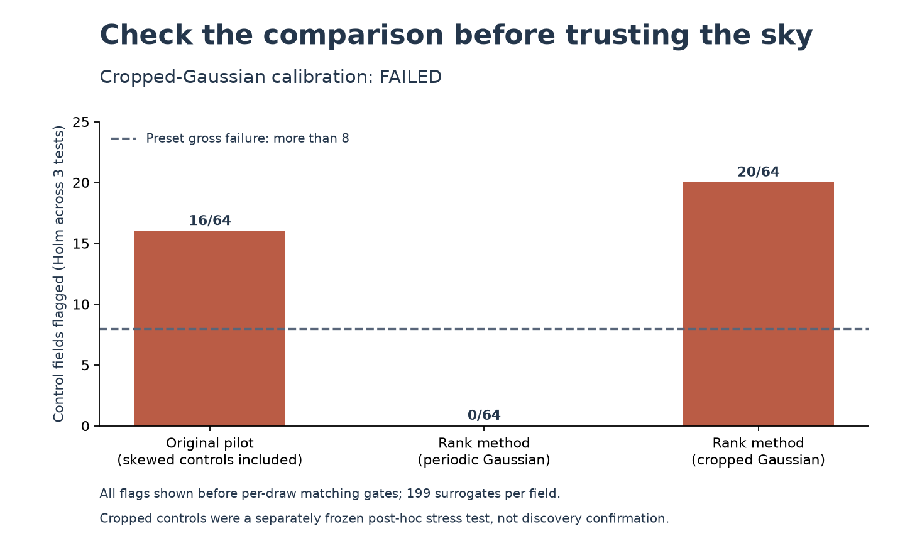
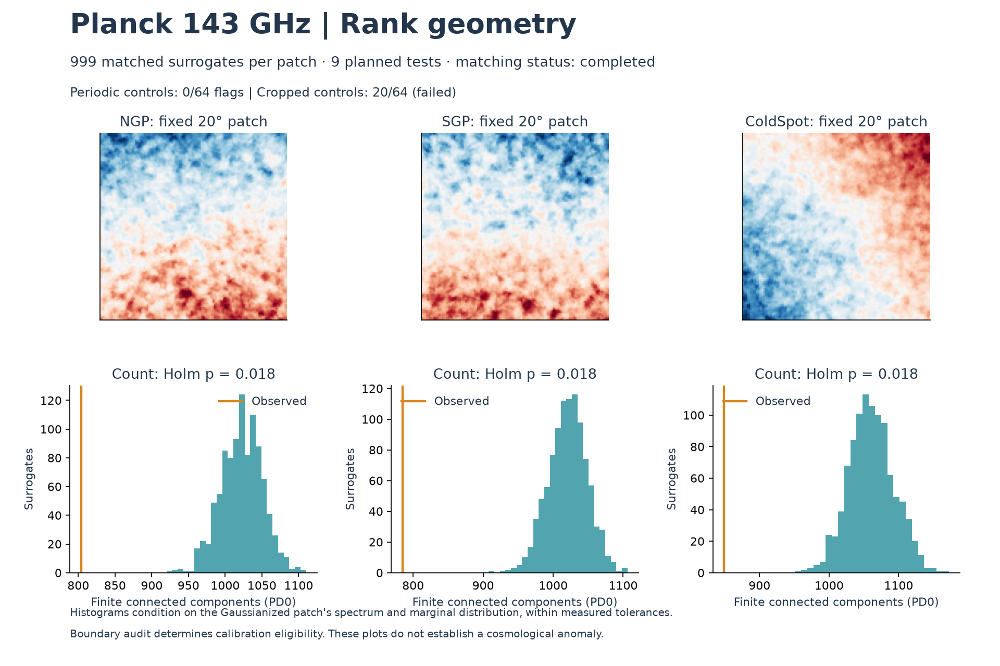

# Exploratory topology beyond Gaussianized two-point structure

Completed 2026-10-23T19:15:10.014822+00:00. Run status: **completed**.
Scientific assessment: **calibration_failed** ([machine-readable assessment](../results/copula_topology_v2/assessment.json)).
9 sky comparisons crossed the numerical threshold and passed matching checks. **The cropped-Gaussian boundary audit failed; these sky flags are not calibrated anomaly evidence.**
Elapsed wall time from plan freeze: 612.1 seconds (10.2 minutes).

## Question and scope

Can the spatial arrangement of temperature-map features differ after removing
brightness-distribution effects and matching the transformed patch's two-point
structure? This is a temperature geometry test, separate from polarization β.
Persistent homology and IAAFT are established methods, not inventions of this lab.
The added experiment is a controlled application to three previously examined
patches. It is exploratory, not blind confirmation.

Sources: [Cole & Shiu, CMB persistence](https://arxiv.org/abs/1712.08159),
[Schreiber & Schmitz, IAAFT](https://arxiv.org/abs/chao-dyn/9909041), and
[TISEAN implementation caveats](https://www.pks.mpg.de/tisean/TISEAN_2.1/docs/docs_f/surrogates.html).

## Why the failed pilot matters

V1's matched-surrogate model failed its fixed calibration gate: 16/64
synthetic examples flagged at the Holm-adjusted .05 level, all in the skewed
monotonic-Gaussian group (16/32), versus 0/32 Gaussian controls. These flags are
before mandatory matching-quality requirements. Only 2/34
fully quality-matched controls flagged. The failed gate blocked sky evaluation.
We retain its [plan](../results/surrogate_topology_v1/plan.json) and
[all controls](../results/surrogate_topology_v1/validation.json).

V2 changes the question explicitly. It maps pixel midranks to normal quantiles;
a strictly monotonic brightness remapping then leaves the input unchanged.
It uses fresh, disjoint seeds and retains the original thresholds. Its held-out
gross-calibration check had 0/64 family-wise flags,
against a preset rejection cutoff of more than eight. There were
0 control-surrogate matching failures
among 12,736 draws. This small synthetic check is not a proof of exact real-sky p-values.

## Every planned comparison

143 GHz A/B mean temperature, 10 arcmin smoothing, ell <=1000, NSIDE512,
128×128 open-boundary 20° NGP/SGP/ColdSpot patches. Each has 999 IAAFT surrogates,
500 iterations. S has exact transformed-field Fourier amplitudes; H has the
exact transformed pixel histogram. Matching both properties exactly in one
finite field is generally impossible. No draws were discarded.

| Patch | Statistic | Observed | Surrogate mean ± SD | Two-sided p | Holm p (9 tests) |
|---|---|---:|---:|---:|---:|
| NGP | finite_PD0_count | 804 | 1022.5 ± 28.25 | 0.002 | 0.018 |
| NGP | total_persistence_H | 120.57 | 195.02 ± 14.58 | 0.002 | 0.018 |
| NGP | total_persistence_S | 120.57 | 194.99 ± 14.57 | 0.002 | 0.018 |
| SGP | finite_PD0_count | 785 | 1020.5 ± 27.9 | 0.002 | 0.018 |
| SGP | total_persistence_H | 127.89 | 198.06 ± 14.58 | 0.002 | 0.018 |
| SGP | total_persistence_S | 127.89 | 198.03 ± 14.57 | 0.002 | 0.018 |
| ColdSpot | finite_PD0_count | 849 | 1060.5 ± 32.44 | 0.002 | 0.018 |
| ColdSpot | total_persistence_H | 96.43 | 186.89 ± 11.17 | 0.002 | 0.018 |
| ColdSpot | total_persistence_S | 96.43 | 186.87 ± 11.16 | 0.002 | 0.018 |

Totals are finite PD0 lifetime sums in normal-score units, not microkelvin.
The component count is invariant under strict monotonic brightness transforms.
The displayed p-values use the predeclared +1-corrected Monte Carlo convention.
They describe the algorithmic surrogate ensemble; they are not probabilities
that cosmology is true or false. The smallest available raw two-sided p is .002.

## Constraint diagnostics and implementation evidence

- Matching failures: **0 / 2,997** real-patch surrogates.
- Largest S exact-spectrum relative error: 4.697e-16 (limit1e-10).
- Largest H spectrum mismatch: 0.0003835 (limit .01).
- Largest S histogram Kolmogorov distance: 0.0003052 (limit .01).
- H histograms and S/H component-count agreement are checked for every draw.
- JoVin surrogate-kernel/recorded-CUDA suite: `20261023T185704Z-58ac2ab53e53`.
- JoVin rank-invariance suite: `20261023T190416Z-f73e0022af1e`.
- Local CPU/GPU parity and shared numerical tests passed.
- Full local regression suite: 175 passed, three unavailable Intel XPU skips.
- [Current source, authentic receipt and frozen-run verification](../results/copula_topology_v2/verification.json).

JoVin establishes the behavior tested in the bundled functions and recomputes
recorded CUDA outputs. It does not validate the astrophysical null assumptions.

## Interpretation limits

### Post-hoc boundary robustness audit

After seeing the pole-patch discrepancies, we identified a control mismatch:
the original 32×32 controls are periodic Gaussian fields; real sky patches
are crops from a larger field. A separately frozen audit used 64 fresh Gaussian
64×64 parents with the same smoothing spectrum, cropped each to its central
32×32 pixels, applied the same normal-score transform, and ran the unchanged
199-surrogate, 500-iteration method and Holm-three test. Nothing in either sky
run was retuned or replaced.

The cropped-Gaussian audit **failed**, with **20/64**
controls flagged (preset gross-rejection rule: more than eight). There were
0 matching failures among 12,736 draws.
This is a post-hoc method stress test, not independent sky confirmation.
Even ordinary Gaussian crops can produce flags in this boundary setting;
the sky p-values remain numerical surrogate tail fractions but lose their
interpretation as calibrated evidence beyond a suitable Gaussian sky model.
Boundary handling changes Fourier conditioning and the algorithmic ensemble;
this audit does not isolate one unique mechanism or establish that it explains
the entire real-sky difference.

[Boundary audit plan](../results/copula_boundary_audit_v1/plan.json),
[all boundary controls](../results/copula_boundary_audit_v1/result.json).

The next valid experiment should generate full Gaussian skies and apply the
same smoothing, spherical pixelization, projection, patch dimensions and edge
handling as the real data. It needs fresh controls and a frozen acceptance rule
before interpreting any sky comparison. A method passing those checks can then
be challenged with detector-split and frequency comparisons. More downloaded
data alone does not repair this control mismatch.

The constraints refer to a Gaussianized finite patch's 2D Fourier spectrum,
not the original spherical C_ell. Periodic Fourier synthesis and open topology
boundaries, patch nonstationarity, foregrounds, correlated noise, finite matching
errors and IAAFT sampling bias remain possible explanations for a discrepancy.
No compact sources were masked into artificial holes. These patches were chosen
in earlier work and already have known topological results. No claim of new
cosmology or superiority over all conventional higher-order statistics follows.

[Frozen V2 specification](COPULA_TOPOLOGY_SPEC.md), [run plan](../results/copula_topology_v2/plan.json),
[held-out controls](../results/copula_topology_v2/validation.json),
[full results](../results/copula_topology_v2/result.json).
