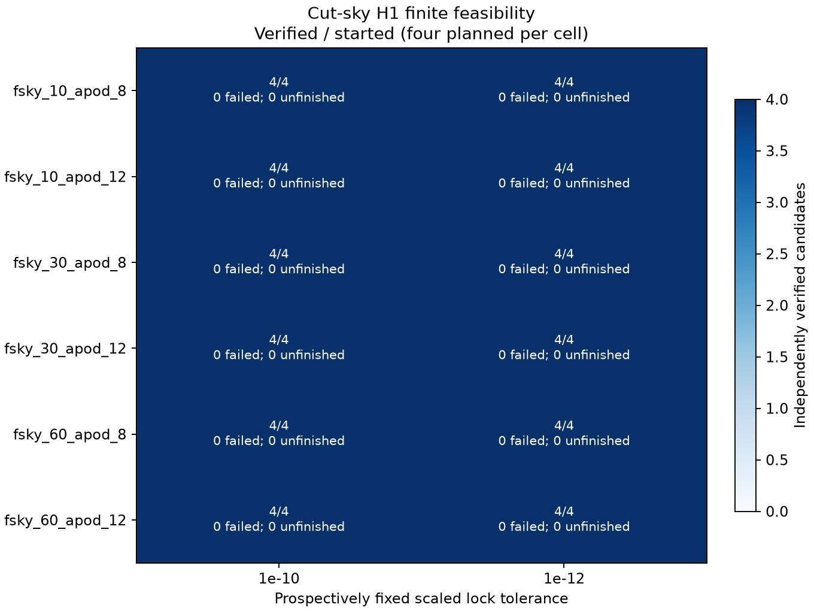
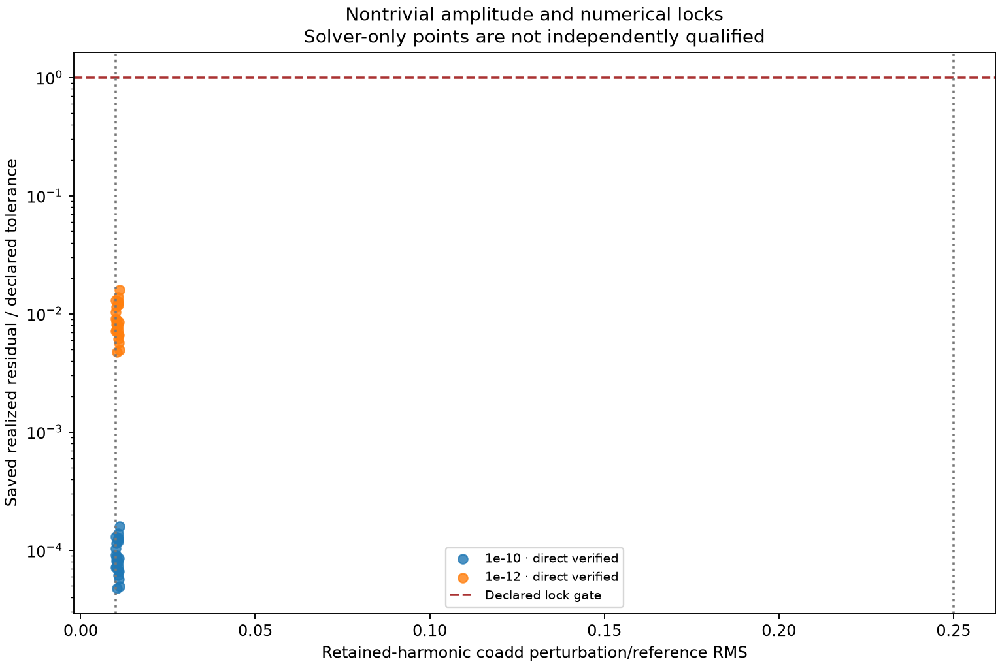

# Cut-sky H1 feasibility pilot

Execution: **complete**. Recorded starts:
**48/48** across
12/12 closed case records.
Independently verified nontrivial candidates: **48**.
Finite searches without a nontrivial candidate: 0.
Numerical/verification failures: 0;
unfinished started rows: 0; unstarted: 0.
Scientific outcome: `finite_feasibility_demonstrated_for_reported_profiles`. A completed unsuccessful
finite search is inconclusive about global feasibility, and is never a closure pass.

## Scope and actual observing operator

This is H1 finite-family feasibility on synthetic split maps, using frozen
NaMaster 3.0.1, ducc and NumPy/CUDA checks.
It tests a common scalar apodized mask, common declared response, COSMO Q/U and
RING ordering. The retained observables are **coupled, binned, realized
pseudo-spectra** for AA, BB and AB, each with EE/EB/BE/BB channels and band edges
[2, 18, 34, 50, 65]. They are neither all unbinned spectra nor decoupled
bandpowers, and no ensemble coupling matrix certifies an individual candidate.
The 48 recorded feature values need not be independent constraints. Saved
solver Jacobian ranks range from 28 to
28 out of 128 angle coordinates,
at the fixed numerical rank cutoff 1e-10. These sampled numerical
ranks establish neither constant rank over a neighborhood nor a global
100-dimensional feasible manifold.
Purification: E=False, B=True; field and mask band limits
are 64 and 64 for this supported NaMaster profile.
Other mask/purification/response combinations remain unsupported until qualified.

The input is simulated Gaussian common sky and independent isotropic split noise; common .02*sin(pixel_index) residual; uK_CMB. Actual FITS/HDF files retain the original
pixel observations. Their unmodeled residual is carried unchanged when a common
synthesized coadd increment is added to both splits. The full spectral Gram
constraint concerns the **canonical retained harmonics**, not an exact inverse
of all pixel data. The empirical A−B difference is checked on those full retained
coefficients and separately on the original observed-map intervention. It is not
a new noise realization or a validated probability law for counterfactual skies.
The full pilot uses **one synthetic input realization and six toy mask profiles**.
It does not establish performance across independent skies, realistic survey
masks, foregrounds, instrumental systematics or calibrated noise ensembles.

## All planned cases

Nominal cap fraction differs from positive pixel fraction and apodized weight.
Each tolerance uses the same four direction identities for a given profile.
There are 24 planned direction streams,
of which 24 started, reused across the two
tolerances to create 48 planned starts. The
24 verified matched pairs are repeated
tolerance checks, rather than independent random-search replications. Their
stricter/looser harmonic RMS ratios range from
1 to
1.
The 128 numerical planes and all parameters remain stored; a
verified finite point does not certify a globally smooth feasible manifold.

| Profile | Tolerance | Started | Verified | None found | Failed | Unfinished | Positive pixel fraction |
|---|---:|---:|---:|---:|---:|---:|---:|
| fsky_10_apod_8 | 1e-10 | 4/4 | 4 | 0 | 0 | 0 | 0.0952962 |
| fsky_10_apod_8 | 1e-12 | 4/4 | 4 | 0 | 0 | 0 | 0.0952962 |
| fsky_10_apod_12 | 1e-10 | 4/4 | 4 | 0 | 0 | 0 | 0.0952962 |
| fsky_10_apod_12 | 1e-12 | 4/4 | 4 | 0 | 0 | 0 | 0.0952962 |
| fsky_30_apod_8 | 1e-10 | 4/4 | 4 | 0 | 0 | 0 | 0.294434 |
| fsky_30_apod_8 | 1e-12 | 4/4 | 4 | 0 | 0 | 0 | 0.294434 |
| fsky_30_apod_12 | 1e-10 | 4/4 | 4 | 0 | 0 | 0 | 0.294434 |
| fsky_30_apod_12 | 1e-12 | 4/4 | 4 | 0 | 0 | 0 | 0.294434 |
| fsky_60_apod_8 | 1e-10 | 4/4 | 4 | 0 | 0 | 0 | 0.59668 |
| fsky_60_apod_8 | 1e-12 | 4/4 | 4 | 0 | 0 | 0 | 0.59668 |
| fsky_60_apod_12 | 1e-10 | 4/4 | 4 | 0 | 0 | 0 | 0.59668 |
| fsky_60_apod_12 | 1e-12 | 4/4 | 4 | 0 | 0 | 0 | 0.59668 |

| Tolerance | Started / planned | Verified | None found | Failed | Unfinished |
|---:|---:|---:|---:|---:|---:|
| 1e-10 | 24/24 | 24 | 0 | 0 | 0 |
| 1e-12 | 24/24 | 24 | 0 | 0 | 0 |

## Amplitude, residual and independent verification

The minimum retained-harmonic perturbation/reference RMS is
0.01; the maximum harmonic and weighted observed-map
ratio is 0.25. Angles are bounded by ±π/4. The original 1e-10
profile and separately declared 1e-12 profile are both reported, without relaxing
either after failures. Every verified row uses reconstructed observed maps and
actual NaMaster fields, and actual evaluation on both GPUs.
Verified harmonic RMS ratios range from
0.0100344 to
0.0111895; weighted observed-map ratios
range from 0.00795922 to
0.0107079. The 1% minimum applies
to the retained harmonics; observed-map amplitude has only the declared upper
bound, and may be below 1%.

The plot shows direct feature residuals for verified points and labels solver-only
points separately. Zero residuals are displayed at 1e-8 of the declared tolerance
for log-axis plotting. Maximum saved direct/model disagreement:
1.50962e-14; maximum actual GPU/direct
disagreement: 1.41141e-14. Maximum canonical
Gram error: 1.61287e-15; canonical D error:
6.14427e-17; observed-map D error:
1.77179e-15.

| Case / start | Outcome | Harmonic RMS ratio | Realized residual (solver-only if uncertified) | Direct/model error | Both-GPU maximum error |
|---|---|---:|---:|---:|---:|
| fsky_10_apod_8_gate_1e-10 / 0 | finite_feasible_candidate_verified | 0.0107461 | 1.18833e-14 | 1.37086e-14 | 7.4716e-15 |
| fsky_10_apod_8_gate_1e-10 / 1 | finite_feasible_candidate_verified | 0.0107251 | 7.23849e-15 | 1.31228e-14 | 9.57298e-15 |
| fsky_10_apod_8_gate_1e-10 / 2 | finite_feasible_candidate_verified | 0.0107466 | 1.38925e-14 | 1.43595e-14 | 1.19079e-14 |
| fsky_10_apod_8_gate_1e-10 / 3 | finite_feasible_candidate_verified | 0.0102745 | 8.14415e-15 | 1.4778e-14 | 5.48695e-15 |
| fsky_10_apod_8_gate_1e-12 / 0 | finite_feasible_candidate_verified | 0.0107461 | 1.18833e-14 | 1.37086e-14 | 7.4716e-15 |
| fsky_10_apod_8_gate_1e-12 / 1 | finite_feasible_candidate_verified | 0.0107251 | 7.23849e-15 | 1.31228e-14 | 9.57298e-15 |
| fsky_10_apod_8_gate_1e-12 / 2 | finite_feasible_candidate_verified | 0.0107466 | 1.38925e-14 | 1.43595e-14 | 1.19079e-14 |
| fsky_10_apod_8_gate_1e-12 / 3 | finite_feasible_candidate_verified | 0.0102745 | 8.14415e-15 | 1.4778e-14 | 5.48695e-15 |
| fsky_10_apod_12_gate_1e-10 / 0 | finite_feasible_candidate_verified | 0.0101476 | 8.64426e-15 | 8.11054e-15 | 2.59463e-15 |
| fsky_10_apod_12_gate_1e-10 / 1 | finite_feasible_candidate_verified | 0.0107507 | 6.13862e-15 | 5.96406e-15 | 2.52081e-15 |
| fsky_10_apod_12_gate_1e-10 / 2 | finite_feasible_candidate_verified | 0.0100344 | 1.04111e-14 | 1.20427e-14 | 3.68072e-15 |
| fsky_10_apod_12_gate_1e-10 / 3 | finite_feasible_candidate_verified | 0.0108693 | 1.27453e-14 | 1.23133e-14 | 3.75481e-15 |
| fsky_10_apod_12_gate_1e-12 / 0 | finite_feasible_candidate_verified | 0.0101476 | 8.64426e-15 | 8.11054e-15 | 2.59463e-15 |
| fsky_10_apod_12_gate_1e-12 / 1 | finite_feasible_candidate_verified | 0.0107507 | 6.13862e-15 | 5.96406e-15 | 2.52081e-15 |
| fsky_10_apod_12_gate_1e-12 / 2 | finite_feasible_candidate_verified | 0.0100344 | 1.04111e-14 | 1.20427e-14 | 3.68072e-15 |
| fsky_10_apod_12_gate_1e-12 / 3 | finite_feasible_candidate_verified | 0.0108693 | 1.27453e-14 | 1.23133e-14 | 3.75481e-15 |
| fsky_30_apod_8_gate_1e-10 / 0 | finite_feasible_candidate_verified | 0.0100541 | 1.30382e-14 | 1.3574e-14 | 3.44728e-15 |
| fsky_30_apod_8_gate_1e-10 / 1 | finite_feasible_candidate_verified | 0.0111678 | 4.96886e-15 | 4.52549e-15 | 2.58546e-15 |
| fsky_30_apod_8_gate_1e-10 / 2 | finite_feasible_candidate_verified | 0.0109983 | 5.72352e-15 | 6.21062e-15 | 2.68556e-15 |
| fsky_30_apod_8_gate_1e-10 / 3 | finite_feasible_candidate_verified | 0.0111895 | 1.59556e-14 | 1.50962e-14 | 2.95796e-15 |
| fsky_30_apod_8_gate_1e-12 / 0 | finite_feasible_candidate_verified | 0.0100541 | 1.30382e-14 | 1.3574e-14 | 3.44728e-15 |
| fsky_30_apod_8_gate_1e-12 / 1 | finite_feasible_candidate_verified | 0.0111678 | 4.96886e-15 | 4.52549e-15 | 2.58546e-15 |
| fsky_30_apod_8_gate_1e-12 / 2 | finite_feasible_candidate_verified | 0.0109983 | 5.72352e-15 | 6.21062e-15 | 2.68556e-15 |
| fsky_30_apod_8_gate_1e-12 / 3 | finite_feasible_candidate_verified | 0.0111895 | 1.59556e-14 | 1.50962e-14 | 2.95796e-15 |
| fsky_30_apod_12_gate_1e-10 / 0 | finite_feasible_candidate_verified | 0.0104894 | 8.13163e-15 | 7.82718e-15 | 3.73529e-15 |
| fsky_30_apod_12_gate_1e-10 / 1 | finite_feasible_candidate_verified | 0.0107481 | 1.23427e-14 | 1.36419e-14 | 2.49804e-15 |
| fsky_30_apod_12_gate_1e-10 / 2 | finite_feasible_candidate_verified | 0.0107821 | 6.75305e-15 | 8.37858e-15 | 5.57011e-15 |
| fsky_30_apod_12_gate_1e-10 / 3 | finite_feasible_candidate_verified | 0.0103911 | 4.79151e-15 | 7.15554e-15 | 4.79281e-15 |
| fsky_30_apod_12_gate_1e-12 / 0 | finite_feasible_candidate_verified | 0.0104894 | 8.13163e-15 | 7.82718e-15 | 3.73529e-15 |
| fsky_30_apod_12_gate_1e-12 / 1 | finite_feasible_candidate_verified | 0.0107481 | 1.23427e-14 | 1.36419e-14 | 2.49804e-15 |
| fsky_30_apod_12_gate_1e-12 / 2 | finite_feasible_candidate_verified | 0.0107821 | 6.75305e-15 | 8.37858e-15 | 5.57011e-15 |
| fsky_30_apod_12_gate_1e-12 / 3 | finite_feasible_candidate_verified | 0.0103911 | 4.79151e-15 | 7.15554e-15 | 4.79281e-15 |
| fsky_60_apod_8_gate_1e-10 / 0 | finite_feasible_candidate_verified | 0.0110202 | 8.54386e-15 | 1.12041e-14 | 1.02857e-14 |
| fsky_60_apod_8_gate_1e-10 / 1 | finite_feasible_candidate_verified | 0.0102763 | 7.20946e-15 | 9.29009e-15 | 6.06121e-15 |
| fsky_60_apod_8_gate_1e-10 / 2 | finite_feasible_candidate_verified | 0.0100823 | 7.16142e-15 | 7.89795e-15 | 5.53973e-15 |
| fsky_60_apod_8_gate_1e-10 / 3 | finite_feasible_candidate_verified | 0.0102843 | 1.13877e-14 | 1.15714e-14 | 6.79591e-15 |
| fsky_60_apod_8_gate_1e-12 / 0 | finite_feasible_candidate_verified | 0.0110202 | 8.54386e-15 | 1.12041e-14 | 1.02857e-14 |
| fsky_60_apod_8_gate_1e-12 / 1 | finite_feasible_candidate_verified | 0.0102763 | 7.20946e-15 | 9.29009e-15 | 6.06121e-15 |
| fsky_60_apod_8_gate_1e-12 / 2 | finite_feasible_candidate_verified | 0.0100823 | 7.16142e-15 | 7.89795e-15 | 5.53973e-15 |
| fsky_60_apod_8_gate_1e-12 / 3 | finite_feasible_candidate_verified | 0.0102843 | 1.13877e-14 | 1.15714e-14 | 6.79591e-15 |
| fsky_60_apod_12_gate_1e-10 / 0 | finite_feasible_candidate_verified | 0.0110049 | 6.6701e-15 | 6.52891e-15 | 4.08914e-15 |
| fsky_60_apod_12_gate_1e-10 / 1 | finite_feasible_candidate_verified | 0.0107054 | 8.04638e-15 | 9.23355e-15 | 6.06776e-15 |
| fsky_60_apod_12_gate_1e-10 / 2 | finite_feasible_candidate_verified | 0.0100601 | 9.06744e-15 | 8.71186e-15 | 6.06776e-15 |
| fsky_60_apod_12_gate_1e-10 / 3 | finite_feasible_candidate_verified | 0.0104682 | 8.84434e-15 | 9.27502e-15 | 1.41141e-14 |
| fsky_60_apod_12_gate_1e-12 / 0 | finite_feasible_candidate_verified | 0.0110049 | 6.6701e-15 | 6.52891e-15 | 4.08914e-15 |
| fsky_60_apod_12_gate_1e-12 / 1 | finite_feasible_candidate_verified | 0.0107054 | 8.04638e-15 | 9.23355e-15 | 6.06776e-15 |
| fsky_60_apod_12_gate_1e-12 / 2 | finite_feasible_candidate_verified | 0.0100601 | 9.06744e-15 | 8.71186e-15 | 6.06776e-15 |
| fsky_60_apod_12_gate_1e-12 / 3 | finite_feasible_candidate_verified | 0.0104682 | 8.84434e-15 | 9.27502e-15 | 1.41141e-14 |

Solver reasons: {'nontrivial_threshold_reached': 48}. These are bounded continuation
outcomes, not global convergence or infeasibility proofs. Recorded execution
failure: `None`.
Partial candidate archives and failed audits remain preserved.

## Budget, provenance and interpretation

The 1800.0-second scientific cap includes preprocessing,
search and verification, with a 180.0-second
verification reserve. Monotonic elapsed: 65.5615 s;
UTC elapsed: 63.8289 s; conservative budget clock:
65.5615 s. Both clocks are retained. Prior frozen
analyses are bound by the new plan's preservation manifest.

[Frozen plan](../results/cutsky_feasibility_v1/plan.json) ·
[Saved result](../results/cutsky_feasibility_v1/result.json) ·
[Input provenance](../results/cutsky_feasibility_v1/inputs/provenance.json) ·
[Metadata and live JoVin authentication](../results/cutsky_feasibility_v1/verification.json)

SHA-256 checks byte identity against bound references. Trust and runtime
authentication depend on separate provenance and receipt verification; neither
establishes correct physics. The 24 existing supporting Lean declarations and
prior studies remain unchanged. This pilot supplies **no future-feature closure
counterexample, statistical sufficiency result, physical-noise validation,
cosmological parameter inference or detector-superiority claim**. Any next phase
requires a separately frozen physical and statistical validation protocol.
