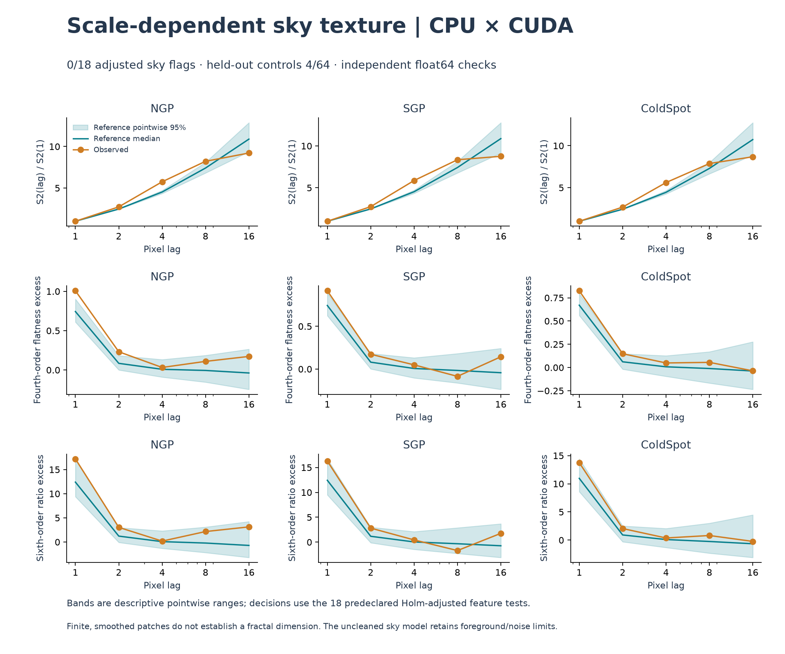

# Finite-scale roughness and intermittency: measured result

**No feature crossed the predeclared adjusted .05 threshold.** The smallest
Holm-adjusted p was **0.18**. The held-out control gate passed with
**4/64** skies flagged; numerical failures: **0**.
This is an exploratory null result for six particular finite-scale features,
not evidence that the sky has no higher-order structure or no fractal process.

## What was tested

We compared the same three previously examined Planck 143 GHz patches with 999
whole-sphere conditional-power skies and 64 held-out controls. The earlier
[whole-sphere model](SPHERICAL_TOPOLOGY_RUN.md) has a substantial amplitude
mismatch. Here six features are invariant to uniform nonzero brightness scale
and offset: S2 log-slope, mean normalized fourth/sixth increment-moment excess,
their two log-slopes, and a bounded directional contrast. They use open-boundary
horizontal/vertical increments at lags 1, 2, 4, 8, 16 pixels. See the
[frozen specification](MULTISCALE_SPEC.md) for exact definitions and gates.

Structure functions and multifractal methods are established. We do not claim
to have invented them or discovered an unknown feature. The 2D scaling literature
requires care about exponent interpretation: [Gu & Zhou](https://arxiv.org/abs/physics/0607194),
[Zhou et al.](https://doi.org/10.1103/PhysRevE.87.012921). This study is not MF-DFA,
does not convert slopes to a Hurst exponent or dimension, and does not establish
an asymptotic scaling law from five lags on a smoothed 128×128 patch.

## Every planned comparison

| Patch | Feature | Observed | Reference mean ± SD | Raw two-sided p | Holm p (18 tests) |
|---|---|---:|---:|---:|---:|
| NGP | S2_log_slope | 0.799741 | 0.847391 ± 0.02978 | 0.09 | 1 |
| NGP | mean_flatness_excess | 0.310716 | 0.163414 ± 0.05125 | 0.01 | 0.18 |
| NGP | mean_sixth_excess | 5.14724 | 2.74059 ± 0.8821 | 0.024 | 0.408 |
| NGP | flatness_log_slope | -0.0729671 | -0.0709221 ± 0.01595 | 0.968 | 1 |
| NGP | sixth_log_slope | -0.172894 | -0.197803 ± 0.04782 | 0.534 | 1 |
| NGP | mean_directional_anisotropy | -0.0148847 | -0.000728293 ± 0.02452 | 0.58 | 1 |
| SGP | S2_log_slope | 0.786636 | 0.846156 ± 0.03086 | 0.054 | 0.864 |
| SGP | mean_flatness_excess | 0.239278 | 0.159467 ± 0.05045 | 0.134 | 1 |
| SGP | mean_sixth_excess | 3.92733 | 2.66846 ± 0.8391 | 0.156 | 1 |
| SGP | flatness_log_slope | -0.0756344 | -0.0716136 ± 0.01537 | 0.828 | 1 |
| SGP | sixth_log_slope | -0.222083 | -0.199359 ± 0.04582 | 0.634 | 1 |
| SGP | mean_directional_anisotropy | 0.00159451 | 0.000570272 ± 0.02464 | 0.948 | 1 |
| ColdSpot | S2_log_slope | 0.778773 | 0.84254 ± 0.03092 | 0.058 | 0.87 |
| ColdSpot | mean_flatness_excess | 0.208465 | 0.143369 ± 0.05092 | 0.21 | 1 |
| ColdSpot | mean_sixth_excess | 3.35418 | 2.36413 ± 0.8228 | 0.224 | 1 |
| ColdSpot | flatness_log_slope | -0.0779146 | -0.0637107 ± 0.01622 | 0.378 | 1 |
| ColdSpot | sixth_log_slope | -0.203003 | -0.177929 ± 0.04796 | 0.624 | 1 |
| ColdSpot | mean_directional_anisotropy | -0.0311594 | 0.00248234 ± 0.02468 | 0.176 | 1 |

The strongest unadjusted indication was the NGP mean flatness excess (raw p=.01),
which becomes .18 under the planned 18-test correction. It is not promoted to a
discovery or used to retune the experiment. The positive phase-coherent control
flagged **17/18** comparisons, demonstrating sensitivity to that
deliberately extreme alternative only. No simulation or failed draw was dropped.
The 999 references and 64 controls reuse the preceding conditional model; they
are not a new independent sky confirmation. Explorations across prior studies
add a broader selection burden beyond this 18-test family.

## CPU, GPU and provenance

Every reference/control curve was independently computed on NumPy CPU and
RTX 5070 CUDA in float64, then compared using abs(CPU-GPU)/(1+abs(CPU)).

- Maximum scaled curve error: **2.522e-14**, limit1e-10.
- Maximum scaled feature error: **3.988e-15**, limit1e-10.
- Maximum relative harmonic-shell power error: **5.107e-15**, limit1e-10.
- CPU feature calls totaled 3.844s; GPU calls including transfer totaled 0.976s.
- Complete audit run, which computed both paths: **169.7s**. These timings do not establish an end-to-end speedup.
- Authentic new JoVin receipt: `20261023T204940Z-b587588deae4`. The sandbox checks shipped CPU code and actual recorded GPU outputs; production CUDA ran separately in WSL.
- All 18 current JoVin suites passed (122 checks including collection); local regression: 181 passed, three unavailable Intel XPU skips. All CI-equivalent sandbox suites passed.

Git now preserves the exact raw bytes identified by frozen SHA256 plans, including
CRLF sources. The staged blobs were cross-checked against working files. Two
regression checks verify historical source/artifact hashes from a checkout.
Redundant progress snapshots remain local; final scientific records, including
the failed experiments, retain every final draw. Hashes identify bytes, not truth,
authorship, statistical validity or cryptographic signatures.

## What Lean establishes

Lean 4.35.0 kernel-checked **9 supporting theorems** over exact
rationals using only its standard library. They prove affine increment
cancellation, homogeneous scaling of finite even-moment sums, normalized fourth/
sixth sample-moment invariance, and directional contrast invariance with explicit
nonzero-denominator assumptions. There are no admitted theorems or extra axiom
declarations. Standard foundations are propext, Classical.choice and Quot.sound.

The compiler archive was checked against the official release SHA256. The
[formal source](../formal/ScaleInvariance.lean), [scope and reproduction instructions](../formal/README.md),
and [compiler/source receipt](../results/multiscale_v1/lean_verification.json)
are preserved. CI repeats the kernel check with the pinned compiler. This is
elementary established algebra, not a new physical theorem. It does not prove
the log-slope summaries, floating-point implementation for all inputs, a sky
anomaly, multifractality, or SHA256 collision resistance.

## Scientific limits

The constants3 and15 are centered-Gaussian population benchmarks; correlated
finite samples, nonzero increment means and pooled directional variance mixtures
can depart from them even for a Gaussian field. Actual simulation references
provide the reported p-values. Affine invariance removes an amplitude nuisance,
not local spectral-shape, anisotropy, foreground or instrument-noise mismatches.
These uncleaned previously studied patches and the global isotropic conditional
model cannot isolate primordial physics or demonstrate unique information beyond
all conventional statistics. No new cosmological or fractal discovery is claimed.

[Immutable plan](../results/multiscale_v1/plan.json),
[all curves/features and precision checks](../results/multiscale_v1/ensemble.json),
[held-out controls](../results/multiscale_v1/validation.json),
[raw result](../results/multiscale_v1/result.json),
[final SHA256/receipt/calculation verification](../results/multiscale_v1/verification.json).
