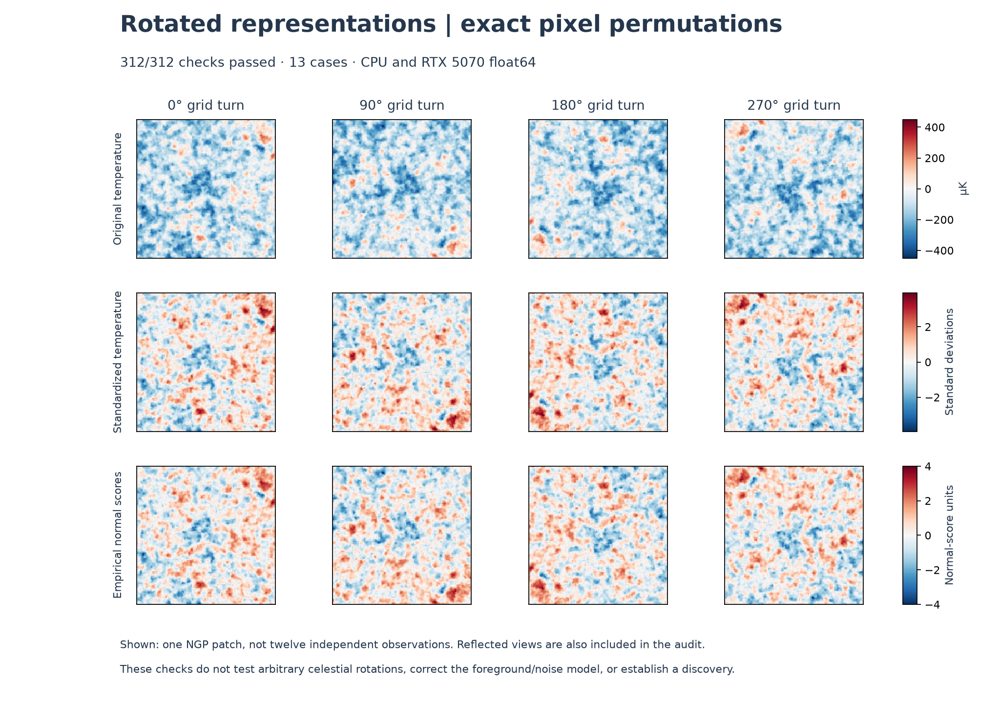

# Rotated representations and research merit

**312/312 exact-grid checks passed; 0 failures.**
Every CPU/CUDA comparison was finite and below the frozen scaled tolerance of
1e-10. This is a numerical symmetry result, not a new sky anomaly. The user
confirmed that “represent and rotate” meant testing rotated representations.

## What actually rotated

We tested all four quarter turns, with and without a horizontal reflection,
for 13 fixed cases: the three previously studied Planck patches, eight fixed-seed
Gaussian fields, a ramp and a spiked field. Each had original, standardized and
empirical normal-score representations. Thus 13 × 3 × 8 = 312 checks.
These transformations permute the pixels exactly and preserve open-grid
adjacency; no interpolation or angle selection enters this audit.

The first five multiscale features stay invariant. The sixth, the signed
horizontal/vertical contrast, reverses sign under odd quarter turns because
the axes swap. Its expected sign change passed; calling it invariant would
misstate the result. Finite PD0 count and total lifetime are invariant under
these grid symmetries **within each representation**. Counts and pixel
histograms passed every exact check. Standardization preserves the six
affine-invariant feature values. Rank normalization changes the scientific
observable, so its feature values need not equal the original values.

| Comparison | Maximum scaled error |
|---|---:|
| CPU/CUDA scale curves | 1.53478e-14 |
| CPU/CUDA compressed features | 5.51847e-15 |
| Rotated/reflected scale curves vs expected values | 1.13882e-14 |
| Rotated/reflected features vs expected values | 3.41816e-15 |
| Total finite PD0 lifetime within each representation | 0 |
| Rank normalization vs permutation order | 1.47901e-16 |
| Standardized vs original affine-invariant features | 4.02074e-15 |

Errors are max(abs(measured−expected)/(1+abs(expected))). The audit took
**24.104s**, including both CPU and GPU paths and topology.
This does not measure an end-to-end GPU speedup. Complete per-case feature
values, expected values, topology summaries and errors are in the
[frozen result](../results/orientation_v1/result.json).

## Where the evidence puts the next effort

The following order is a research judgment from the saved results, not a
calculated discovery score. No angle, representation or threshold was selected
to make the earlier sky comparisons pass.

| Priority | Evidence now | Next useful test and merit criterion |
|---|---|---|
| 1. Justify the foreground/noise reference | The whole-sphere model predicts patch spread around 399–401 µK, while the observed patches are 96.6–101.4 µK. Both topology count and conventional spread flag; unique topology information is unestablished. | Specify foreground treatment, frequency/split checks, noise and identical map operators before another sky test. First require held-out null calibration and conventional baseline diagnostics. |
| 2. Test actual spherical rotation/projection dependence | This audit removes exact grid-axis relabeling as a numerical explanation for these features. It does not rotate the celestial sphere or instrument pipeline. | Freeze an SO(3) orientation set and common sampling/mask rules; process controls identically. Quantify interpolation and boundary effects and use a joint rotation-aware decision rule, not the most favorable angle. |
| 3. Test added information on independent targets | The multiscale study has 0/18 adjusted flags, minimum p=.18; its raw p=.01 indication does not survive its planned correction. Previously examined patches are not independent confirmation. | Predeclare a bounded feature family and independent data, with a conventional-statistic comparator and power/false-alarm checks. Advance only on calibrated, reproducible added information. |

The earlier periodic/cropped control failure (20/64 flags) stays visible in
[the copula report](COPULA_TOPOLOGY_RUN.md). The spherical model's own controls
flagged 2/64, and the multiscale controls 4/64; passing those gross diagnostic
gates does not validate the real sky foreground or noise assumptions.
See [spherical results](SPHERICAL_TOPOLOGY_RUN.md) and
[all multiscale comparisons](MULTISCALE_RUN.md). No physical cause has been isolated.

## Reproducibility and proof scope

The plan freezes source bytes, fixed seeds, patch-cache SHA256 and JoVin receipt
**`20261023T212557Z-3470461f116f`** before measurement. The new JoVin suite passed
5/5 checks including collection. The
[fresh verification](../results/orientation_v1/verification.json) checks all
19 current suite bundles/test hashes against authentic receipts and verifies
chain membership, earlier frozen sources and earlier saved artifact hashes.
JoVin sandbox checks run on CPU; this audit's independent production CUDA
comparisons ran in the existing WSL GPU environment. Hash agreement establishes
byte identity and receipt linkage, not scientific validity or universal novelty.

The existing [nine Lean rational invariants](../formal/README.md) remain
unchanged. They do not prove D4 topology invariance, arbitrary floating-point
correctness or cosmology. No new physical finding is offered for formalization.

Arbitrary celestial rotations can change projected pixels, foreground/noise
alignment and boundary effects. This exact-grid check is a limited prerequisite
for that distinct experiment; it does not establish SO(3) invariance or a
fractal dimension. Normal-score and standardized views are derived versions of
the same observations, not additional data or independent replications.

[Frozen specification](ORIENTATION_SPEC.md),
[immutable plan](../results/orientation_v1/plan.json),
[all 312 records](../results/orientation_v1/result.json),
[receipt/source/artifact verification](../results/orientation_v1/verification.json).
