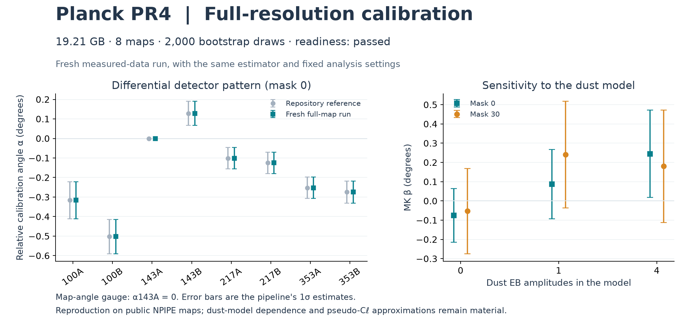

# Full-resolution Planck scale-up

The complete **19.210 GB** public input set has been downloaded into `data/raw/`.
All **12 scientific input audits passed**. The full-resolution reproduction
**completed successfully** under WSL `JovinHarness` on 23 October 2026 at
1:35 pm America/Chicago. All **4,026 fits converged**, including 2,000 bootstrap
draws, and every recorded parameter, covariance and likelihood was finite.

## Data acquired

- Eight NPIPE detector-split maps: A/B at 100, 143, 217 and 353 GHz.
- Each map has NSIDE 2048, or **50,331,648 sky pixels**, with Stokes and covariance columns.
- Galactic-plane and polarized point-source masks, the CO foreground product,
  and the QuickPol beam archive containing all 64 required A/B beam members.
- Exact payload total: **19,210,190,296 bytes** across 12 files.

Official sources: [NERSC NPIPE release](https://portal.nersc.gov/project/cmb/planck2020/)
and ESA Planck Legacy Archive. The [dataset inventory](../data/evidence/planck_dataset.json)
records URLs, sizes, HTTP validators and locally computed SHA256 hashes. These
hashes identify the downloaded bytes; they are not publisher-signed digests.

The [input audit](../data/evidence/planck_input_audit.json) rehashed each file,
checked FITS structure and advertised checksums, verified actual detector A/B
source identities, map units, polarization convention, pixel counts and mask
columns, and confirmed the required beam archive members. Missing publisher
checksums are explicitly recorded as absent.

## Completed computation

The [saved plan](../data/evidence/planck_full_resolution_plan.json) selects:

- The established mask construction and 72 multipole bins, 51 ≤ ℓ < 1491.
- Eight simulated transfer skies per mask and **2,000 bootstrap draws**.
- Eight CPU threads for ducc0 transforms; CUDA device 0 for precision-gated
  Wishart Gram products. Covariance assembly and inference stay in float64.
- New cache `data/work/rtx5070_real/` and results `results/rtx5070_real/`.

The rebuilt masks cover 0.919999977 and 0.600424170 of the sky, matching the
repository's reference construction. Measured results agree with the retained
reference to numerical precision:

| Quantity | Fresh run | Repository reference |
|---|---:|---:|
| Network residual χ² / 21 dof, mask 0 | 28.758500 | 28.758500 |
| Network residual χ² / 21 dof, mask 30 | 30.674709 | 30.674709 |
| MK β ± 1σ, mask 0 | 0.245179° ± 0.227362° | 0.245179° ± 0.227362° |
| MK β ± 1σ, mask 30 | 0.180465° ± 0.292143° | 0.180465° ± 0.292143° |
| Network–MK comparison χ² / 7 dof | 3.2334, PTE 0.8626 | 3.3181, PTE 0.8541 |

The largest per-map calibration difference from the reference is 5.3 × 10⁻¹⁵
degrees; the largest pair-angle difference is 7.3 × 10⁻¹⁴ degrees. The MK β
differences are below 2.6 × 10⁻¹⁰ degrees. The network–MK comparison uses a
bootstrap covariance: CUDA and the historical XPU run use different random
streams, so their finite-sample comparison statistics differ.

Dust assumptions remain consequential. On mask 0, β is −0.0752° ± 0.1401°
with zero dust EB amplitudes, +0.0873° ± 0.1803° with one, and
+0.2452° ± 0.2274° with four. Acquiring the full maps reproduces that structural
sensitivity; it does not remove it or establish a new cosmological detection.

| Stage | Wall time |
|---|---:|
| Masks | 43.4 s |
| Full-resolution harmonic transforms | 686.0 s |
| Cross-spectra | 23.7 s |
| Transfer estimation, eight skies per mask | 122.5 s |
| Analysis, including the bootstrap | 551.7 s |
| **Total computation** | **1,427.8 s (23 min 48 s)** |

Download and input-audit time are excluded. The 2,000-draw bootstrap took
534.6 seconds; the retained Intel run records 405.4 seconds. Those are different
machines and execution environments, not a controlled hardware benchmark, so
no end-to-end GPU speedup is established. Full-sky transforms and float64
likelihood fitting remain CPU work.

[Stage audit](../results/rtx5070_real/stage_audit.json),
[fit audit](../results/rtx5070_real/fit_audit.json),
[measured results](../results/rtx5070_real/reproduction.json) and
[execution log](../data/full_planck_run.log) retain the evidence. The observer
passed dimensions, positive uncertainties/covariances, closure identities,
bootstrap count/convergence and actual GPU precision. There were zero rejected
fits; the largest fit iteration count was 15. The measured GPU normalized error
was **2.1491 × 10⁻⁷**, below the **10⁻⁵** acceptance limit.

## Verification and scientific limits

- **14 JoVin suites passed**, including the new HTTP framing and FITS-size helper
  suite. Current source and test hashes match their authentic receipts.
- New data-integrity receipt: `20261023T175103Z-7966048f9fc7`.
- CUDA attestation receipt: `20261023T173220Z-0f5c704fb64f`.
- Validation-time count: **173 local tests passed, 3 skipped** for unavailable Intel XPU hardware.
- [Receipt ledger](../data/evidence/jovin_receipts.json).
- [Final source, artifact and receipt validation](../data/evidence/planck_final_validation.json).

JoVin verifies the bundled numerical helpers in its isolated science environment;
the full-resolution map run and actual CUDA execution take place in the host WSL
environment and have separate input, stage and fit records. This is a new execution
of the existing analysis on public measured data, not a new blind discovery test.
The pseudo-Cℓ approximation, reconstructed masks and dust-model sensitivity remain
part of the method's limits. The eight transfer skies per mask leave Monte Carlo
uncertainty in transfer estimation. The 2,000 bootstrap draws provide a parametric
covariance estimate under the existing bandpower model, not a new end-to-end
instrument simulation. Spatial and NPE blind analyses, persistence tests, and
their frozen reference artifacts were not rerun in this reproduction.

The plot was rendered from the saved results and visually inspected.
