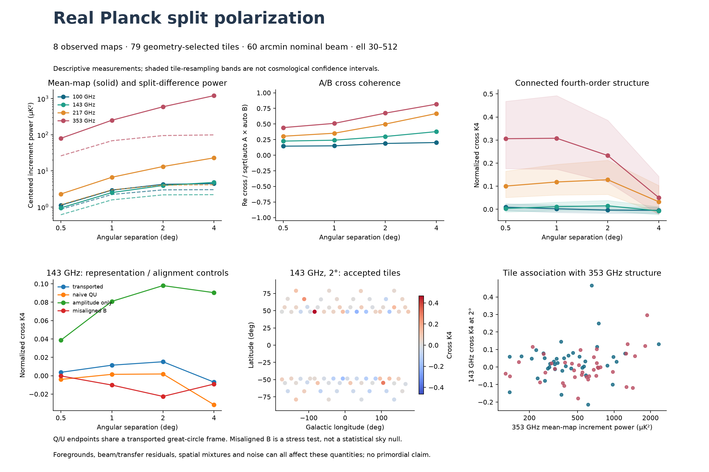

# Real Planck split-polarization measurement

**Completed: 79 accepted sky tiles, 13,665 anchors and
215,796 valid sampled pairs in 586.58 seconds.**
This run reads the actual eight NPIPE A/B Q/U maps, not synthetic replacement skies.
The outcome is an exploratory measurement, with zero recorded numerical failures;
no calibrated sky anomaly, fractal dimension or method-superiority claim follows.

## Frozen real-data question

Measure which polarization increment patterns recur between detector splits,
how coordinate handling and amplitude-only representations change those summaries,
and how a connected fourth-order descriptor varies alongside ordinary power.
The [frozen protocol](REAL_SPLITS_SPEC.md) fixes all frequencies, scales, mask rules,
descriptors and resampling before extraction. Related sky regions were previously
inspected; this is not blind confirmation or a test of the earlier learned detector.

Input bytes are freshly SHA256-checked against the existing audited inventory.
Each map contains 50,331,648 NSIDE2048 pixels. Only Q/U are analyzed here.
The input files total 16,106,204,160 bytes. The 3-degree mask
margin and tile exclusions use geometry/counts only. All candidate tile counts,
including exclusions, are retained in [tiles.json](../results/real_splits_v1/tiles.json).

The spin-2 area-weighted adjoint at lmax 512 is not an exact inverse of a HEALPix
map. Ell 30–512 are retained and filtered toward a nominal 60 arcmin beam using
actual diagonal auto QuickPol EE/BB responses. This is diagonal effective beam
equalization; it does not remove anisotropic beams, cross-component mixing,
mapmaking transfer or all contamination. The common pixel window remains.
Invalid source pixels are counted and zero-filled; their counts are published.

## Results at the predeclared reading point: 2 degrees

Each number is an equal-weight average of accepted tile-level centered quantities.
The bands are 2.5/97.5 percentiles of 2000 tile resamples. Spatially related tiles
and modes are dependent, so these are **resampling stability bands, not confidence
intervals or detection significance**. All four scales appear in the figure and
complete arrays; none was selected for a favorable result.

| GHz | Cross S2 (µK²) | Split-difference S2 (µK²) | A/B coherence | Normalized cross K4 | K4 stability band |
|---:|---:|---:|---:|---:|---|
| 100 | 1.27162 | 2.98608 | 0.18795 | -0.00338 | [-0.01695, 0.01157] |
| 143 | 1.76449 | 2.17265 | 0.29963 | 0.01518 | [-0.00611, 0.03865] |
| 217 | 9.16195 | 4.03833 | 0.49884 | 0.12805 | [0.06438, 0.21258] |
| 353 | 498.91 | 94.8923 | 0.67432 | 0.23307 | [0.11858, 0.38599] |

Cross S2 is Re(Eab*) after tile/lag centering. The mean-map increment power minus
split-difference power equals it algebraically; maximum scaled identity error
was 5.3e-14. Split differences contain noise and
residual signal/beam/bandpass/systematic mismatches. They are not certified
pure-noise maps. High coherence does not identify a cosmological source.

K4 subtracts the Gaussian/Wick pair products from E|a|²|b|² and normalizes by
the two variances. It is an established connected fourth-order descriptor,
not a newly proved method, unbiased finite-sample estimator or evidence of
information absent from every standard approach. Within-tile variance mixtures,
foregrounds, noise and residual instrumental effects can make it nonzero.

## Representation and alignment controls

At 143 GHz and 2 degrees:

| Representation | Coherence | Cross K4 |
|---|---:|---:|
| transported | 0.299633 | 0.0151807 |
| naive_QU | 0.2994 | 0.00187207 |
| amplitude_only | 0.131996 | 0.0980652 |
| misaligned_B | -0.00618342 | -0.0225497 |

Transported Q/U expresses both ends in their shared great-circle frame. Naive Q/U
subtraction compares different local reference axes. Amplitude-only increments
discard polarization direction. These descriptors therefore ask different questions;
a larger value does not establish a better detector. Uniform physical rotation of
both splits remains degenerate for the invariant summaries; no absolute angle is fit.
Taking a magnitude is nonlinear: Gaussian Q/U do not imply Gaussian amplitude
increments. Those representations therefore do not share one Gaussian reference.

The misaligned-B control rolls valid B increments within each tile/lag, preserving
their marginal samples and breaking exact alignment. It is a stress test, not an
exchangeable or foreground-matched null. Its outcomes produce no p-values.

The tile rank association of 143 GHz K4 with 353 GHz mean increment power at
2 degrees is 0.13744.
[All 16 associations](../results/real_splits_v1/association.json) are reported as
descriptive coefficients, without independence p-values or causal attribution.
Frequency dependence and repeatability need foreground/end-to-end modeling
before any primordial or new-physics interpretation.

## Numerical and provenance evidence

| Actual GPU | Maximum scaled difference from all CPU tile statistics | Wall seconds |
|---|---:|---:|
| NVIDIA GeForce RTX 5070 | 4.59e-15 | 12.155 |
| NVIDIA GeForce GTX 1660 Ti | 4.59e-15 | 14.819 |

All 2000 real-feature tile resamples are independently reproduced on CPU.
Each GPU computes 1000 draws plus the same first 32 draws as a cross-device check.
The preset scaled precision tolerance is 1e-10, without threshold/seed tuning.
The [sampling replay](../results/real_splits_v1/sampling_replay.json) separately
evaluates all eight retained filtered harmonic sets, with a direct/grid spin-2
operator control. It also reanalyzes the complete raw 143A Q/U map using inverse
pixel-index gathering and explicit filter algebra, compared with production's
forward index scattering. The ducc transform backend remains shared; this is
not an independent physical instrument model or a replay of all eight raw maps.
The raw 143A scaled harmonic difference was 7.33001e-17.
The separate direct/grid sampling control reached 9.28464e-11,
below but close to the preset 1e-10 gate. Its tolerance, epsilon and seed were
not changed to improve that margin. Replay of the eight retained coefficient
sets gave maximum scaled sample difference 0;
that repeatability shares the sampling algorithm and is not an accuracy proof.

The new authentic JoVin receipt is `20261024T002321Z-3b4b0dd2589d`. The sandbox
checks exact shipped CPU kernels, an independent transported-tensor/gauge oracle,
Gaussian and heavy-tail controls, and recorded real CUDA outputs from both cards.
It does not run CUDA or the full Planck preprocessing inside the sandbox.
Local regression: 195 passed, three unavailable Intel XPU skips; all 24 current
CI-equivalent sandbox suites passed. Fresh [verification](../results/real_splits_v1/verification.json)
authenticates all 24 current suites (158 checks including collection), current
source/test hashes, independent real-coordinate covariance calculations,
resamples, labeled rows and preservation of all prior frozen artifacts.

The first development fixture exceeded JoVin's 262144-byte test input limit;
it was rejected before execution. Its original test/source, actual GPU record
and failed admission ledger entry remain. A compact fixture passed the same
unchanged profile. [Admission record](../data/evidence/real_splits_fixture_admission.json).
The earlier eleven Lean rational identities are unchanged. No empirical or
new physical theorem is claimed from this observational measurement.

## Execution and reproducibility

| Stage | Seconds |
|---|---:|
| geometry seconds | 5.712 |
| hash read transform sample seconds | 564.266 |
| cpu statistics seconds | 0.547 |
| both gpu statistics wall seconds | 15.190 |
| resampling seconds | 0.781 |

CPU transforms, fresh file hashing and direct spherical sampling dominate this
workflow. GPU reductions/resampling are real but light; this does not claim
saturated GPUs or end-to-end GPU speedup. [Device-wide phase-tagged telemetry](../results/real_splits_v1/telemetry.json)
includes other applications. Production completed within the 3600-second cap.

[Actual filtered labeled rows](../results/real_splits_v1/labeled_real_samples.csv)
include map/split, sky pixel, Galactic coordinates, angular separation, bearing,
mask validity, Q/U and transported increments. No fictitious time or radial-depth
column is added. Endpoint arrays, phases, masks, tile statistics, resamples and
all filtered harmonics are retained alongside the frozen plan.

Sources: [NPIPE release](https://portal.nersc.gov/project/cmb/planck2020/),
[NPIPE processing/split design](https://doi.org/10.1051/0004-6361/202038073),
[ducc operator definitions](https://mtr.pages.mpcdf.de/ducc/sht.html).

The earlier foreground/reference mismatch and negative method comparisons remain
unresolved. These measurements provide real-data constraints for future controls;
they do not repair that reference or validate cosmological significance.
