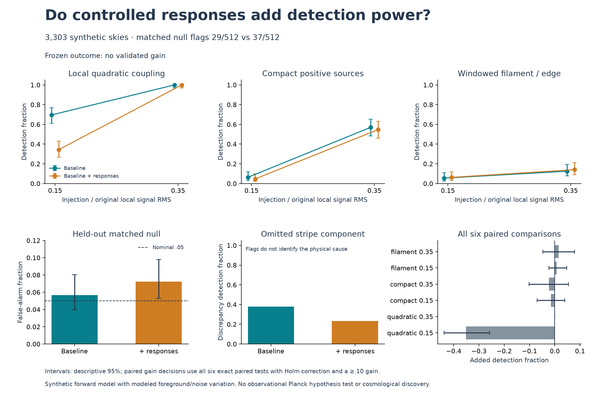
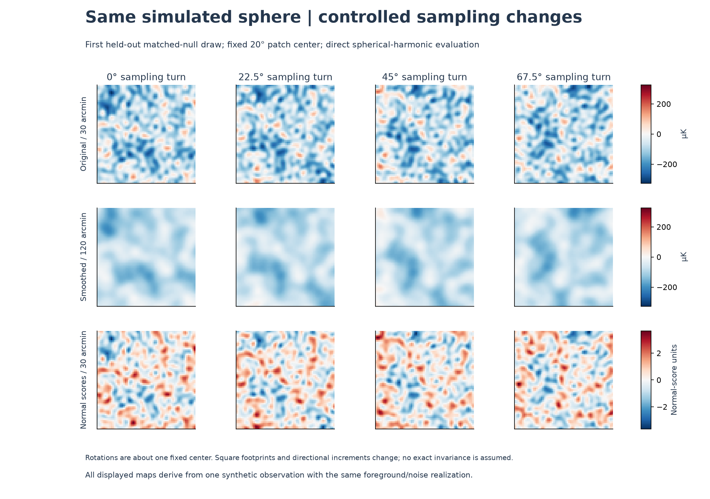

# Controlled spherical response benchmark V1

**Outcome: no_validated_gain.** No comparison met the complete predeclared added-power rule.
This is a synthetic method-development result. No observational Planck
hypothesis test was performed, and no new physical or fractal discovery is claimed.

The largest measured loss was quadratic_0.15: baseline 89/128 versus augmented 44/128, a -35.16 percentage-point change.

## The proposed method

The user authorized combining controlled feature responses with a test of added
information. We measured geometry at four spherical sampling orientations,
three smoothing scales and two representations of the same synthetic sky.
The 90 fixed response contrasts summarize how six established finite-scale
features and three excursion Euler characteristics change under those operators.
The 17-value baseline already includes moments, two-point increment statistics,
the six finite-scale features and the three Euler values in the original view.

Ridge regression, fitted only to 768 null training draws, predicts responses
from baseline features. The augmented detector scores the joint baseline and
response residual vector, using fixed covariance shrinkage. Residualization
alone does not prove independence, nuisance immunity or added information;
the held-out comparison measures the latter within this benchmark.

The locations are actual gnomonic coordinates on a sphere, at 0,22.5,45,67.5°
around one fixed center, evaluated directly from band-limited harmonics rather
than by rotating a raster. Rotated square footprints and directional increments
change. This is a response experiment, not an exact symmetry test or coverage
of all SO(3) orientations. All components receive the same smoothing/sampling.

## Forward model and withheld observations

All3303 skies use a fiducial CAMB lensed TT spectrum through ell256, with Gaussian
harmonic directions conditional on fixed shell powers. This is not a full
non-Gaussian lensed CMB simulator. Each observation includes an explicit synthetic
Galactic-band foreground proxy with amplitude Uniform(0,60)µK and anisotropic
band-limited noise with amplitude Uniform(5,25)µK. These vary in training,
calibration and matched validation. The three injected alternatives are local
quadratic coupling, compact positive sources and a windowed filament/edge.
Their modified signal shell powers are restored before nuisance addition.
Full formulas, seeds and limits are in the [frozen protocol](RESPONSE_SPEC.md).

This controlled forward model replaces the inadequate observational reference
**for the benchmark only**. The previous Planck model's local spread mismatch
remains unresolved. None of these synthetic nuisance templates establishes a
physical Planck noise/foreground fit; observational testing remains withheld.

## Calibration and every planned comparison

Training768, independent calibration999, matched null512, six alternative groups
of128, and an omitted-stripe stress test256. Both methods use upper-tail
plus-one Monte Carlo p-values against their own calibration score distribution,
with nominal p<=.05. They share data and calibration draws, allowing paired
comparison; the finite realized false-alarm rates need not be identical.

- Baseline null flags: **29/512 (5.664%)**;
  Wilson95% [3.972%, 8.016%].
- Augmented null flags: **37/512 (7.227%)**;
  Wilson95% [5.288%, 9.802%].
- Gross calibration gate: **passed**, at most40 flags for each
  method. Nuisance-amplitude subgroup counts are retained in validation.json.

The augmented Wilson95% interval lies above the nominal5% rate. Passing the gross cutoff must not be described as precise false-alarm calibration; finite-reference variability and model/score adequacy still need assessment.

| Injection | Baseline detected | + responses detected | Gain | Paired bootstrap95% | Exact paired p | Holm p (6) | Provisional gain |
|---|---:|---:|---:|---|---:|---:|---|
| quadratic_0.15 | 89/128 | 44/128 | -35.16 pp | [-43.75, -25.78] pp | 1 | 1 | no |
| quadratic_0.35 | 128/128 | 128/128 | +0.00 pp | [+0.00, +0.00] pp | 1 | 1 | no |
| compact_0.15 | 8/128 | 6/128 | -1.56 pp | [-7.03, +3.91] pp | 0.80615 | 1 | no |
| compact_0.35 | 73/128 | 70/128 | -2.34 pp | [-10.16, +5.47] pp | 0.78782 | 1 | no |
| filament_0.15 | 7/128 | 8/128 | +0.78 pp | [-2.34, +4.69] pp | 0.5 | 1 | no |
| filament_0.35 | 16/128 | 18/128 | +1.56 pp | [-4.69, +7.81] pp | 0.40181 | 1 | no |

The gain rule requires the matched-null gate, all numerical checks, at least
10 percentage points of added detection and Holm p<=.05 across all six paired
tests. Intervals condition on the fitted models and reference; they do not
include uncertainty from retraining/recalibration. No failed draw was dropped,
and no seed, feature, amplitude, model penalty or threshold was retuned.

The omitted stripe component flagged **97/256**
baseline and **60/256** augmented cases.
These are model-discrepancy detections, not matched-null false alarms or
identification of primordial physics. This limited stress test cannot cover
unknown unknowns in general or isolate physical causes.

## Numerical execution and evidence

- Numerical/finite-value failures: **0/0**.
- Maximum scaled baseline CPU/CUDA difference: **8.34833e-15**.
- Maximum scaled response difference: **2.08141e-14**.
- Maximum scaled score difference: **1.12004e-14**.
- Maximum relative signal-shell power error: **2.77556e-15**.
- Fixed tolerance1e-10; covariance condition numbers: [62.00523316895466, 76.3148743985472].
- Complete audit: **203.3s**, including both feature paths.
  Forward CPU operators: 104.38s; CPU rank preprocessing:
  49.12s; CPU feature calls: 29.96s;
  CUDA feature calls including transfers: 8.69s.
  These timings do not establish an end-to-end GPU speedup.

Spherical synthesis, shared rank preprocessing and training fit run on CPU;
CUDA independently computes moment curves, excursion complexes, response
aggregation and final scores. The earlier multiscale compression step is shared
CPU code. JoVin's new9/9 suite checks shipped NumPy kernels and a real recorded
CUDA fixture; production CUDA runs separately in WSL. The spherical forward
class is source-frozen and locally tested, rather than claimed to execute in
the NumPy-only JoVin sandbox.

New authentic JoVin receipt: `20261023T215313Z-4fb94bd93228`. All20 current suites
match their authentic receipts (136 checks including collection); regression185
passed, three unavailable Intel XPU skips; all20 CI-equivalent CPU suites passed.
A [separate30-case CPU replay](../results/response_v1/replay.json) regenerates
three fixed indices per role using the frozen kernels and stored fiducial C_ell.
It is separate execution, not an independent physical simulator.
The [final verification](../results/response_v1/verification.json) recomputes
training transformations, scores, tails, paired tests, Holm decisions, intervals
and all frozen bindings, with fresh authentic receipt-chain membership checks.

The CUDA development record predates a corrected quarter-turn assertion in a
development test; its recorded fixture values and numerical source hashes remain
unchanged. The actual JoVin receipt binds the corrected tests used at freeze.
Earlier scientific artifacts and the nine Lean rational invariants remain intact.
No Lean proof establishes detection power or validity of this synthetic model.

## What would justify advancing it

This comparison covers the specified17 baseline summaries and six synthetic
alternatives. Broader added-information or novelty claims require benchmarks
against bispectrum/scattering methods, more realistic nuisance models, sensitivity
to changes in the training distribution and genuinely withheld observational
checks. Frequency and detector splits share the same sky, so they are useful
contamination checks rather than independent universes.

Relevant prior work includes [nuisance-hardened compression](https://arxiv.org/abs/1903.01473),
[spherical scattering](https://arxiv.org/abs/2407.07007) and
[model-misspecification tests](https://arxiv.org/abs/2412.15100). This pilot uses
ridge residualization, not the first paper's efficient-score construction;
the response features are not a scattering transform. Any useful novelty in
the combination remains a hypothesis requiring a focused literature comparison.

[Plan](../results/response_v1/plan.json),
[conditioning](../results/response_v1/conditioning.json),
[all features/scores/draw parameters](../results/response_v1/ensemble.json),
[fitted model](../results/response_v1/model.json),
[validation](../results/response_v1/validation.json),
[result](../results/response_v1/result.json),
[stage audit](../results/response_v1/stage_audit.json),
[verification](../results/response_v1/verification.json).
