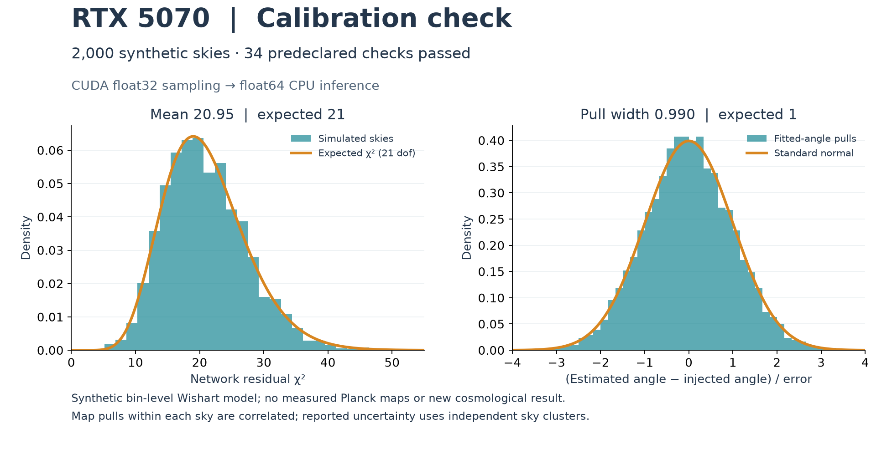

# RTX 5070 calibration run — 23 October 2026

The RTX 5070 (12 GB, compute capability 12.0) now runs the existing Wishart
Gram sampler through PyTorch CUDA. The first fixed 2,000-simulation synthetic
calibration passed all 34 prespecified checks. No Planck maps were downloaded;
the published real-sky results were not recomputed.



## Measured result

| Check | Measured | Reference |
|---|---:|---:|
| Deterministic GPU Gram normalized error | 1.8412 × 10⁻⁷ | ≤ 10⁻⁵ |
| Pooled recovered-angle pull mean | −0.0058 | 0 |
| Pooled pull width | 0.9902 | 1 |
| One/two-sigma coverage | 68.56% / 95.78% | 68.27% / 95.45% |
| Mean pair χ² | 27.873 | 28 |
| Mean network residual χ² | 20.945 | 21 |

The injected eight-map calibration pattern, common β = 0.3°, intrinsic sky
EB/EE = 0.03, seed 20261023, 14 bins, batch size 32, and five-Monte-Carlo-standard-error
acceptance limits were written to an immutable prespecification before sampling.
Uncertainty groups correlated map pulls within each independent simulated sky.
β is an injected nuisance parameter here, not an inferred cosmological result.

The main run took 20.91 seconds after prespecification: 2.27 seconds in generation
and 17.93 seconds fitting on the CPU. Environment installation and initial device
discovery are excluded. In a separate 50-draw comparison, CPU Bartlett took
0.0267 seconds and CUDA Gram took 0.0839 seconds including its precision check.
These are different algorithms generating the same Wishart law, not a hardware
speedup comparison. CPU inference is the main bottleneck in this experiment.

## Actual JoVin verification (calibration-run state)

This workstation uses the reliability-upgraded harness under
`D:/JovinHarness_Artifacts`, **not** the older `D:/jovin-harness` checkout.
The enhanced CST science profile is `D:/SSI_Artifacts/jovin-cst`, running
`wsl:JovinHarness` with 30-second / 2-GiB limits. It adds pytest and Hypothesis to
the science image while preserving the upgraded runner and isolation checks.
Image: `sha256:b125b813cae0052127f1dc0e7e6353ead2ba10ebcac3c4fd42a10eae468a0ed7`.

- All **13 JoVin suites passed: 94 checks**, including 13 harness collection checks.
  The [README receipt table](../README.md#verification) lists the current suites;
  the counts and receipts here describe the calibration run.
- Final CUDA attestation receipt: `20261023T173220Z-0f5c704fb64f`.
- Synthetic summary/injection helper receipt: `20261023T173137Z-48cb897d1a8b`.
- The receipt chain verified: 40 receipts, head
  `9d348753d4c555a78f248b02c3874dda439503e788814313f12a85474853db6e`.
- Local WSL pytest: **134 passed, 3 skipped**. The skips were unavailable Intel XPU
  cases; actual CUDA precision, draw statistics, and float64-output tests ran.

The adapter checks receipt content hashes, exact submitted source/test hashes,
linked membership, sandbox admission, kernel checks, image/runner identity,
container removal, and full chain validity. Tests use shared-interpreter
isolation because they exercise NumPy arrays and classes; this is explicitly
recorded and is weaker than process isolation. Receipts are hashes, not signatures.
The sandbox recomputes recorded GPU matrices on CPU; it does not execute CUDA.
The 2,000-draw hardware experiment runs separately in WSL and records its own
prespecification, device metadata, source hashes, timings and per-draw statistics.

Historical Intel GPU and NPU attestation records are preserved. The new CUDA
record has its own measurement timestamp and source hash. Without the map cache,
attestation uses the historical Planck bin sizes (2,245 / 28,741 / 54,501) with
deterministic synthetic normals, explicitly labeled in the evidence.

## Reproduce on this workstation

Windows Application Control blocks the installed native GPU DLLs and the harness
executable launcher. The installed harness Python module works; CUDA computation
uses an isolated Linux environment `/opt/cmb-cst-gpu` inside the existing WSL
distribution. No Windows security settings or external harness source were changed.
The environment contains PyTorch 2.14.1+cu130 and the lab's scientific/test dependencies.

Run from the repository in PowerShell:

```powershell
& 'D:/JovinHarness_Artifacts/environments/windows/Scripts/python.exe' -B scripts/jovin_verify.py --harness-python 'D:/JovinHarness_Artifacts/environments/windows/Scripts/python.exe' --data-dir 'D:/SSI_Artifacts/jovin-cst' --runtime wsl:JovinHarness
```

Run a new GPU experiment without overwriting the retained result:

```powershell
wsl -d JovinHarness --cd / -- bash -lc 'mkdir -p /mnt/e; mountpoint -q /mnt/e || mount -t drvfs E: /mnt/e; cd "/mnt/e/New folder/cmb-cst-lab" && CMB_CST_DEVICE=cuda:0 OPENBLAS_NUM_THREADS=1 OMP_NUM_THREADS=1 /opt/cmb-cst-gpu/bin/python scripts/run_gpu_calibration.py --output results/gpu_calibration_new.json'
```

Replace the script/arguments with `scripts/gpu_attest.py --device cuda:0` to
refresh attestation, or `-m pytest -q --basetemp /tmp/cmb-cst-pytest` for local tests.
`CMB_CST_DEVICE` accepts `auto`, `cpu`, `cuda:N`, or `xpu:N`; explicit unavailable
devices fail rather than silently falling back. CUDA products use IEEE float32
with scoped TF32 disabling; covariance assembly and fitting stay float64.

The repository `.mcp.json` also targets this upgraded harness/profile. The current
session used the actual CLI module because a JoVin MCP tool was not attached.

## Retained artifacts

- [Results and raw per-draw statistics](../results/gpu_calibration.json)
- [Pre-run design](../results/gpu_calibration.prespec.json)
- [Fresh and historical accelerator records](../data/evidence/gpu_attestation_latest.json)
- [Authentic JoVin receipts](../data/evidence/jovin_receipts.json)
- [Experiment runner](../scripts/run_gpu_calibration.py)

For this small covariance workload, Bartlett sampling already avoids the large
random matrices that a GPU Gram sampler must form. A larger GPU should therefore
be evaluated on batched inference or larger workloads before claiming a practical
end-to-end speed advantage. Full-resolution sky transforms remain on ducc0/CPU.
