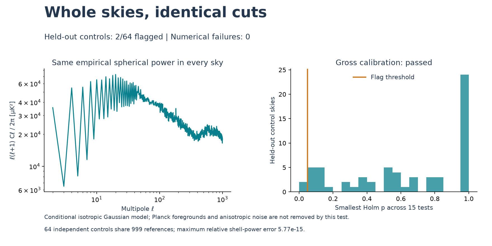
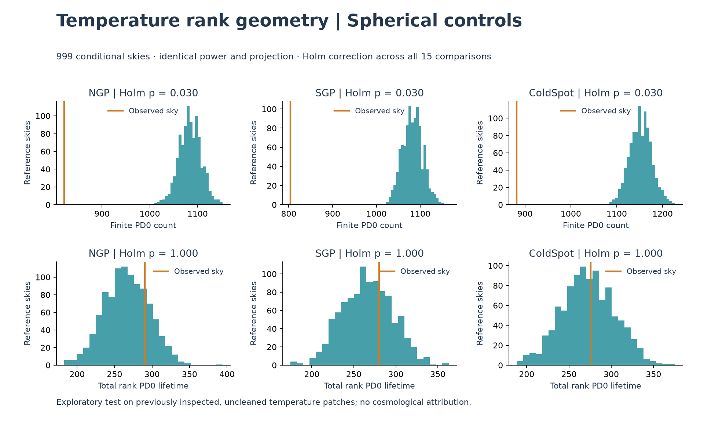

# Whole-sphere conditional-power topology run

Completed 2026-10-23T20:27:33.522273+00:00; status **exploratory_complete**. 3/6 topology comparisons and 3/9 conventional-moment comparisons crossed adjusted p<=.05 within the conditional isotropic model. These are exploratory diagnostic flags, not new cosmology.

The ordinary spread comparison shows a large model/data mismatch: real patch standard deviations are 96.6–101.4 µK, versus reference means 399.2–400.9 µK. The global uncleaned spectrum spread isotropically is not representative of these high-latitude patches. Foreground concentration is a plausible contributor, not an isolated causal finding. Rank topology is invariant under uniform amplitude rescaling, so the spread difference alone does not mechanically explain the component counts. Local spectral shape and anisotropy remain possible explanations; higher-order-specific or unique topological information is not established.

## What changed and why

The previous flat-patch test falsely flagged 20/64 cropped Gaussian controls.
We preserve [that failure](COPULA_TOPOLOGY_RUN.md). This new null generates
whole spherical skies, then applies the same 10 arcmin smoothing, NSIDE512
pixelization, gnomonic projection and 128×128 open-boundary 20° NGP/SGP/ColdSpot
cuts to data and simulations. The ell=0,1 coefficients are zeroed in both.
No patch-periodic Fourier matching or source-mask holes are introduced.

Each ell>=2 harmonic shell has the exact empirical full-sphere C_ell of the
143 GHz A/B mean temperature. Gaussian real harmonic coordinates are normalized
to those shell powers. Under an isotropic Gaussian scalar model, shell directions
are uniform conditional on the powers. The null therefore changes spatial
arrangement while preserving the spherical two-point spectrum. Individual
harmonic magnitudes and pixel histograms are not preserved. This is a different
conditioning question from the preceding Gaussianized flat-patch experiment.

The real coefficients come from the area-weighted adjoint at NSIDE2048, not an
asserted exact inverse. Every comparison starts with band-limited coefficients
and uses the identical downstream sampling operator. See the
[ducc0 operator definitions](https://mtr.pages.mpcdf.de/ducc/sht.html) and
[established persistence context](https://arxiv.org/abs/1712.08159).

## All real-sky comparisons

| Patch | Statistic | Observed | Reference mean ± SD | Two-sided p | Holm p (15 tests) |
|---|---|---:|---:|---:|---:|
| NGP | rank_PD0_count | 821 | 1084.02 ± 23.2 | 0.002 | 0.03 |
| NGP | rank_total_PD0_lifetime | 290.193 | 266.279 ± 29.81 | 0.452 | 1 |
| NGP | temperature_std_uK | 98.1198 | 399.482 ± 42.13 | 0.002 | 0.03 |
| NGP | temperature_skewness | 0.085535 | 0.00127442 ± 0.1811 | 0.586 | 1 |
| NGP | temperature_excess_kurtosis | 0.153938 | -0.0941716 ± 0.2403 | 0.278 | 1 |
| SGP | rank_PD0_count | 804 | 1082.75 ± 23.06 | 0.002 | 0.03 |
| SGP | rank_total_PD0_lifetime | 280.212 | 266.182 ± 29.81 | 0.652 | 1 |
| SGP | temperature_std_uK | 96.6061 | 399.158 ± 42.62 | 0.002 | 0.03 |
| SGP | temperature_skewness | -0.090757 | -0.00889604 ± 0.1838 | 0.644 | 1 |
| SGP | temperature_excess_kurtosis | 0.0634748 | -0.100784 ± 0.2392 | 0.42 | 1 |
| ColdSpot | rank_PD0_count | 882 | 1152.14 ± 24.1 | 0.002 | 0.03 |
| ColdSpot | rank_total_PD0_lifetime | 275.694 | 272.664 ± 31.3 | 0.904 | 1 |
| ColdSpot | temperature_std_uK | 101.416 | 400.894 ± 42.31 | 0.002 | 0.03 |
| ColdSpot | temperature_skewness | -0.0773174 | -0.0121835 ± 0.1822 | 0.696 | 1 |
| ColdSpot | temperature_excess_kurtosis | 0.0516076 | -0.093128 ± 0.2426 | 0.48 | 1 |

Topology uses empirical normal scores and finite PD0 components/lifetimes.
Conventional temperature standard deviation is in microkelvin; skewness and
excess kurtosis use standardized original temperature. Rank lifetimes are
dimensionless. All 15 comparisons use one Holm family and the +1-corrected
two-sided Monte Carlo convention; the smallest attainable raw p is .002.
A difference between rejection decisions is not a validated superiority or
incremental-information test. These previously studied patches are not blind
confirmation, and the full-sphere spectrum is not every local two-point statistic.

## Calibration, precision and positive control

- Held-out controls: **2/64 flagged**; preset rejection if more than eight.
- All reference and held-out skies used identical power and map/projection operators.
- Numerical/finite-value failures: **0**.
- Maximum relative C_ell error: **5.773e-15**, limit1e-10.
- Zero-power shells and real m=0 coefficients were checked for every sky.
- Positive phase-coherent control: 6/6 topology and 7/9 moment tests flagged; all target powers matched.

The positive control is deliberately extreme and only demonstrates sensitivity
to one alternative; it is not a realistic primordial non-Gaussian benchmark.
The 64 controls share the reference ensemble, so their flag events are dependent.
The gross cutoff is a diagnostic, not a binomial significance claim or proof
that Planck foreground/noise assumptions are correct.

## JoVin and execution evidence

The new shipped numerical bundle and actual recorded RTX CUDA projection were
checked by JoVin receipt `20261023T201811Z-764956b0e705`. JoVin checks the recorded
output on CPU; the actual CUDA computation ran separately in the existing WSL
environment. Every production sky was independently checked against its fixed
power by NumPy. Indexed CUDA reductions can vary in final rounding bits.
All **17 current JoVin suites passed (116 checks including collection)**;
the local regression suite had **177 passed, three unavailable Intel XPU skips**.

Environment: NVIDIA GeForce RTX 5070; PyTorch 2.14.1+cu130, CUDA 13.0,
NumPy 2.5.4, ducc0 0.42.0; eight CPU transform threads.
Wall time after plan freeze: **416.6 s (6.9 min)**,
including 55.1 s to hash/read both input maps
and prepare harmonic coefficients. No end-to-end GPU speedup is claimed;
spherical synthesis and topology remain CPU work.

[Final authentic receipt/source/result verification](../results/spherical_topology_v1/verification.json)
records the current suites, local test result and all frozen bindings.
The source Planck files were rehashed in this run, matched to the audited
inventory, and referenced in [conditioning provenance](../results/spherical_topology_v1/conditioning.json).

## What the supplied CST package contributed

The archive's five supplied checksums matched. Its reviewed mathematical script
was replayed unchanged in a separate working folder: **27/27 checks passed**.
The package's original results were not overwritten. This was a local replay,
separate from the JoVin CMB suite; it establishes no CMB, neural-model or market
performance. [Package evidence](../data/evidence/cst_package_audit.json) records
archive/content hashes, the NumPy version, every check and the scope distinction.

We used the working paper's explicit-projection and negative-control principles
(sections7.2,8.1) to specify this test. We did not adopt embedded document commands
as user instructions or claim an exact operational quotient for these summaries.
The package provides no new physical model for this temperature-map test.

## Scientific limits

The empirical spectrum contains foregrounds and noise from an uncleaned
143 GHz map. Uniform isotropic shell directions remove their spatial coherence
and do not model anisotropic/correlated instrument noise or all beam effects.
Any difference can reflect these known ingredients, statistical anisotropy or
higher-order structure. It does not isolate primordial non-Gaussianity,
establish unique information unavailable to every conventional statistic,
improve polarization β, or establish new CST physics. A clean cosmological
claim would require justified foreground/noise modeling and independent data.

[Frozen specification](SPHERICAL_TOPOLOGY_SPEC.md),
[immutable plan](../results/spherical_topology_v1/plan.json),
[all skies and precision audits](../results/spherical_topology_v1/ensemble.json),
[held-out controls](../results/spherical_topology_v1/validation.json),
[positive control](../results/spherical_topology_v1/positive_control.json),
[raw result](../results/spherical_topology_v1/result.json),
[scientific assessment](../results/spherical_topology_v1/assessment.json).
