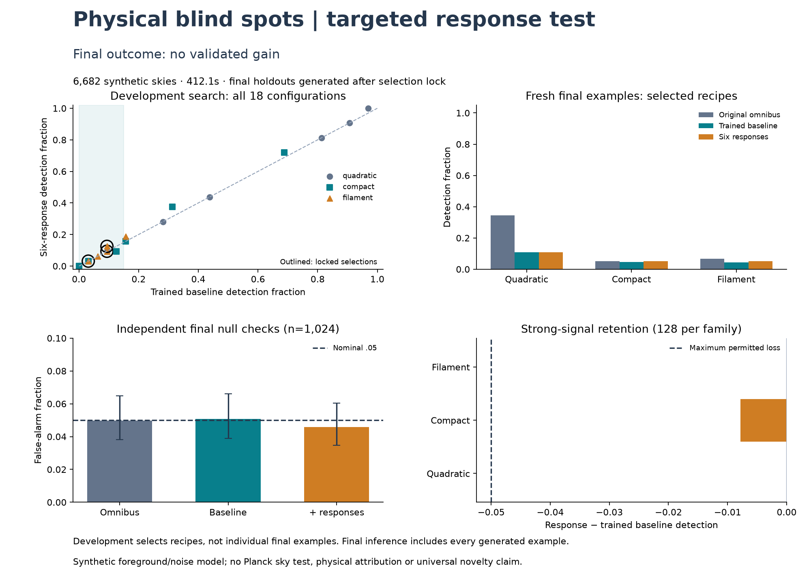

# Targeted physical blind-spot benchmark

**Final outcome: no_validated_gain.** Calibration gate: **True**;
strong-signal retention gate: **True**. No physical or
observational Planck finding is established by this synthetic experiment.

The original omnibus detected **88/256** selected quadratic examples, compared with **28/256** for the trained baseline and **28/256** for six responses. For this selected case, the result suggests a scoring-rule limitation rather than absence of information from the conventional summaries.

## What changed

The first90-response detector failed its merit comparison. This separate version
uses exactly six predeclared geometric/moment responses, residualized against
the same17 conventional summaries using null-only ridge regression. The six
measure raw/rank Euler response to orientation, and raw/rank fourth-moment and
Euler response to smoothing. The learned models have17 and23 coordinates.
Both have three linear family heads, equal training data and fixed covariance
shrinkage. Each complete maximum score is calibrated against independent null
examples. The original omnibus score is a reported comparator, not a selection gate.

The forward model, continuous spherical sampling orientations and nuisance
amplitude distributions are the earlier explicit synthetic model. Quadratic
coupling signs±1 and localized widths .5/1degree vary across18 recipes. Injection
amplitudes .1/.2/.3 are specified before harmonic-power restoration; final effective
map changes need not equal those fractions. These are physically motivated
patterns, not a realistic Planck foreground/noise simulator.

## Every development comparison

Training:1024 nulls plus64 per recipe; development calibration499 nulls,
diagnostic null256, and32 examples per recipe. The null diagnostic flags
(omnibus/baseline/responses) were **[12, 19, 22]**.
Eligibility requires trained-baseline detection<=15%. Select the largest measured
gain per eligible family, breaking ties by lower amplitude then recipe ID.
Development gains are selected estimates and are not confirmation evidence.
Eligibility is relative to the trained linear-head baseline. A selected recipe
may still be detectable by the original omnibus statistic; all three methods
remain visible. A paired gain would not establish that the17 summaries contain
no information or that conventional methods generally have this blind spot.

| Recipe | Family | Amplitude | Sign / width(deg) | Baseline | Responses | Difference |
|---|---|---:|---:|---:|---:|---:|
| q00 | quadratic | 0.1 | -1 | 9.375% | 9.375% | +0.000% |
| q01 | quadratic | 0.1 | 1 | 28.125% | 28.125% | +0.000% |
| q02 | quadratic | 0.2 | -1 | 43.750% | 43.750% | +0.000% |
| q03 | quadratic | 0.2 | 1 | 81.250% | 81.250% | +0.000% |
| q04 | quadratic | 0.3 | -1 | 90.625% | 90.625% | +0.000% |
| q05 | quadratic | 0.3 | 1 | 96.875% | 100.000% | +3.125% |
| c00 | compact | 0.1 | 0.5 | 12.500% | 9.375% | -3.125% |
| c01 | compact | 0.1 | 1.0 | 3.125% | 3.125% | +0.000% |
| c02 | compact | 0.2 | 0.5 | 15.625% | 15.625% | +0.000% |
| c03 | compact | 0.2 | 1.0 | 0.000% | 0.000% | +0.000% |
| c04 | compact | 0.3 | 0.5 | 68.750% | 71.875% | +3.125% |
| c05 | compact | 0.3 | 1.0 | 31.250% | 37.500% | +6.250% |
| f00 | filament | 0.1 | 0.5 | 6.250% | 6.250% | +0.000% |
| f01 | filament | 0.1 | 1.0 | 3.125% | 3.125% | +0.000% |
| f02 | filament | 0.2 | 0.5 | 9.375% | 9.375% | +0.000% |
| f03 | filament | 0.2 | 1.0 | 9.375% | 12.500% | +3.125% |
| f04 | filament | 0.3 | 0.5 | 15.625% | 18.750% | +3.125% |
| f05 | filament | 0.3 | 1.0 | 9.375% | 9.375% | +0.000% |

Selected IDs: `{"compact": "c01", "filament": "f03", "quadratic": "q00"}`.
The [selection lock](../results/targeted_v1/selection_lock.json) binds model,
development records, initial plan and the exact final role manifest before
any final sample is generated. Final examples are never filtered by whether
the baseline misses them. Old study holdouts were not reused.

## Fresh final evaluation

Calibration999 nulls; validation1024 nulls;256 examples per selected family;
128 strong controls per family at amplitude .35. Both detectors use nominal
p<=.05, with plus-one inclusive upper tails of the complete maximum score.

| Method | Null flags /1024 | Rate | Wilson95% |
|---|---:|---:|---|
| Original omnibus | 51 | 4.980% | [3.808%, 6.489%] |
| Trained baseline | 52 | 5.078% | [3.893%, 6.599%] |
| Six responses | 47 | 4.590% | [3.469%, 6.050%] |

The trained baseline and augmented Wilson upper bounds must each be<=7.5%;
augmented rate must be<=baseline+1percentage point. All three strong-control
losses must be<=5percentage points. These are preset benchmark gates, not proof
of physical model adequacy.

| Strong family | Omnibus | Trained baseline | Six responses | Baseline − responses (loss) |
|---|---:|---:|---:|---:|
| quadratic | 128/128 | 126/128 | 126/128 | +0.000% |
| compact | 88/128 | 94/128 | 93/128 | +0.781% |
| filament | 18/128 | 22/128 | 22/128 | +0.000% |

| Family / selected recipe | Omnibus detections | Baseline | Responses | Gain | Paired p | Holm p(3) | Provisional gain |
|---|---:|---:|---:|---:|---:|---:|---|
| quadratic / q00 | 88/256 | 28/256 | 28/256 | +0.000% | 0.6875 | 1 | False |
| compact / c01 | 13/256 | 12/256 | 13/256 | +0.391% | 0.5 | 1 | False |
| filament / f03 | 17/256 | 11/256 | 13/256 | +0.781% | 0.3125 | 0.9375 | False |

Promotion requires all gates,>=10percentage points added sensitivity and a
one-sided paired exact test with Holm p<=.05 across three families. Missing
families receive p=1. Raw records include descriptive2000-resample paired
bootstrap intervals, conditional on the fitted model/calibration reference.
No thresholds, features, seeds or models were changed after the freeze.

## Execution and evidence

- Completed **6682 draws in 412.11s**, below the1800s cap.
- Numerical failures: **0**.
- Maximum scaled CPU/CUDA feature error: **1.81777e-14**.
- Maximum scaled end-to-end score error: **2.22208e-14**; limit1e-10.
- Separate CPU replay: **94 samples**, status **passed**.
- Spherical synthesis, rank preprocessing and fitting are CPU work; feature
  kernels/aggregation and final scoring execute independently on CUDA float64.
  Total timings include both paths and do not establish end-to-end GPU speedup.
- New JoVin receipt: `20261023T223751Z-b7ba43ffca03`. All21 current suites authenticate
  (142 checks including collection); local tests189 passed, three unavailable
  Intel XPU skips. All21 CI-equivalent CPU suites passed. JoVin checks numerical
  kernels and recorded real CUDA outputs; it does not run the spherical simulator.

[Fresh verification](../results/targeted_v1/verification.json) checks source/test
hashes against authentic receipts and chain membership, independently reconstructs
model fits, scores, selection, tails and final decisions, and checks preservation
of prior frozen artifacts. The replay reuses frozen kernels and is a separate
execution, not an independently designed physical simulator. Existing Lean
rational invariants remain unchanged; no new formal theorem or empirical
detection-power proof is claimed.

The Planck foreground/reference mismatch remains unresolved. A benchmark gain,
if present, is limited to these baselines and specified synthetic distributions.
Broader tests, a focused novelty review and observational contamination checks
would be needed before any real-sky or methodological-priority claim.

[Protocol](TARGETED_SPEC.md), [plan](../results/targeted_v1/plan.json),
[development](../results/targeted_v1/development.json),
[model](../results/targeted_v1/model.json),
[final samples](../results/targeted_v1/final.json),
[result](../results/targeted_v1/result.json),
[stage audit](../results/targeted_v1/stage_audit.json),
[replay](../results/targeted_v1/replay.json).
